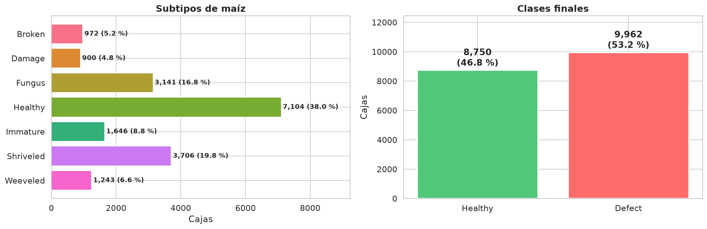
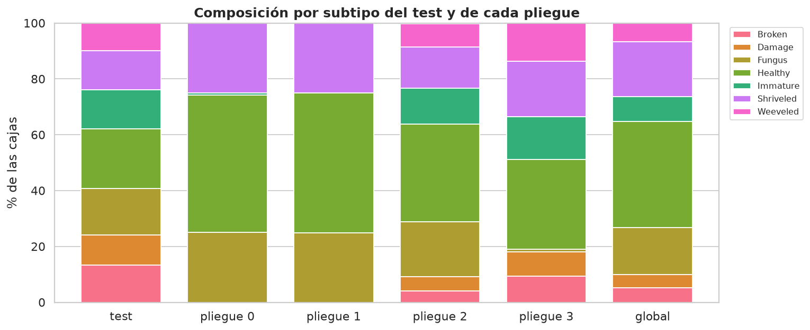
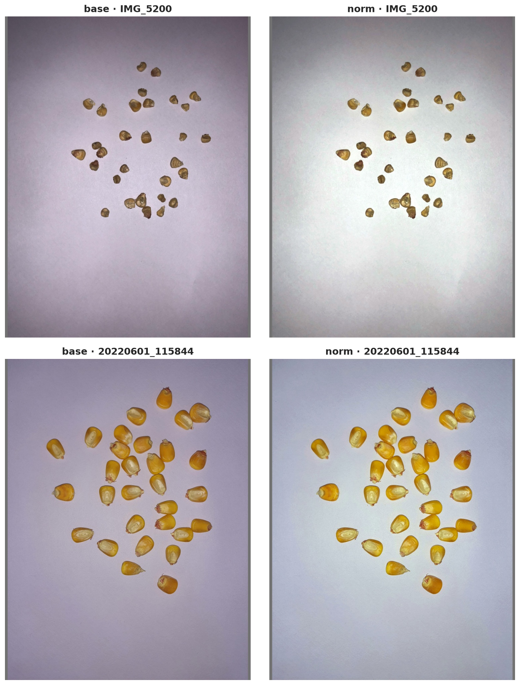
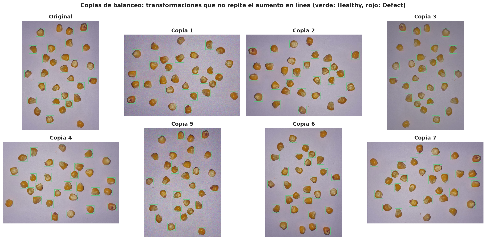
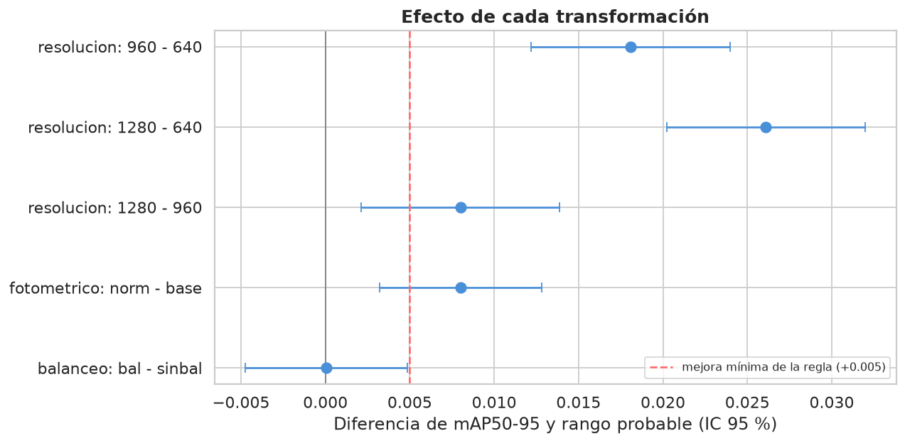
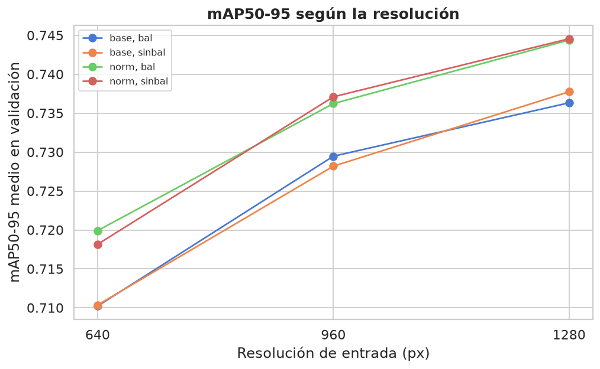
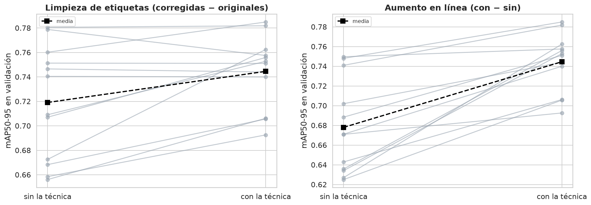

# Informe 1.2: Ingeniería de Datos

| | | | |
| :--- | :--- | :--- | :--- |
| **Proyecto:** | Detección de defectos en granos de maíz con YOLOv11 | **Fecha:** | 28 - 10 - 2026 |
| **Objetivo:** | Objetivo Específico 1, Actividad 1.2 | **Notebooks:** | `1.2_ingenieria_datos.ipynb`, `nube/1.2_experimentos_colab.ipynb`, `1.2_experimentos.ipynb` |
| **Entrada:** | `datos/Data_corr_v6` (669 imágenes con las etiquetas corregidas) | **Figuras:** | `salida/1.2_ingenieria_datos/`, `salida/1.2_experimentos/` |

---

## 1. Planteamiento

El PIIC pide "determinar qué transformaciones benefician realmente al conjunto de datos", probando la limpieza, la estandarización, la normalización, el balanceo y el aumento de datos. El criterio seguido es **decidir de forma analítica lo que no requiere entrenar y experimentar solo con lo que sí**.

| Transformación | Cómo se decide | Resultado |
| :--- | :--- | :--- |
| Limpieza de etiquetas | Corrección en Roboflow (`1.2_limpieza_etiquetas.md`) y experimento complementario | **Aplicada**: +0.026 de mAP50-95 (sección 9.5) |
| Consolidación a 2 clases | Analítica (EDA y Codex CXS 153-1985) | `Healthy` / `Defect` |
| Partición | Por lote de captura | Test fijo + 4 pliegues |
| Estandarización geométrica | Analítica (requisito de YOLO) | Letterbox a múltiplo de 32 |
| Normalización de píxeles a [0, 1] | La hace el dataloader de Ultralytics | — |
| Resolución (640 / 960 / 1280) | Experimento | **1280** |
| Normalización fotométrica (Gray World) | Experimento | **Aplicada** (`norm`) |
| Balanceo de clases | Experimento | **Sin balanceo** |
| Aumento de datos | Analítica (en línea, no offline) y experimento complementario | **En línea**: +0.067 de mAP50-95 (sección 9.5) |

## 2. Consolidación a 2 clases

`Healthy` + `Immature` → **Healthy**; `Broken`, `Damage`, `Fungus`, `Shriveled` y `Weeveled` → **Defect**.
- **Se retiran 156 imágenes** que solo contienen impurezas u otras semillas. Dejarlas con etiquetas vacías enseñaría a la red a ignorar objetos de forma parecida a los granos. Quedan reservadas como posibles fondos negativos para el OE2.
- **En 9 imágenes mixtas** se conservan solo las cajas de maíz.

Resultado: **513 imágenes y 18 712 cajas**, con una razón Defect/Healthy de 1.14.

## 3. Partición por lote de captura

La partición original tenía fuga (fotos de la misma bandeja en particiones distintas). Además, fotos tomadas con pocos minutos de diferencia suelen ser el mismo lote de granos reacomodado. Por eso la unidad indivisible de partición es el **lote**: fotos separadas por 5 minutos o menos, o hasta 5 posiciones de contador.

**Los lotes se calculan con las 669 fotos**, antes de retirar las de impurezas y otras semillas. Una foto retirada puede ser la que une dos capturas consecutivas: por ejemplo, entre `IMG_6179` (maíz) e `IMG_6185` (maíz) hay cuatro fotos de impurezas. Si los lotes se calcularan después de retirarlas, aparecería un salto artificial de 6 posiciones y un mismo lote podría quedar repartido entre conjuntos.

- **Test (~15 %):** lotes completos, estratificados por subtipo. **No se usa en ninguna decisión** hasta la evaluación final del OE2.
- **Desarrollo:** 4 pliegues por lote para la validación cruzada.
- **Elección de la semilla:** entre 300 semillas de `StratifiedGroupKFold`, la que mejor representa al subtipo peor cubierto. Solo se usan etiquetas.

Las 513 imágenes con maíz forman **19 lotes**, de 1 a 120 imágenes.

| Conjunto | Imágenes | Lotes | Cajas | % Healthy |
| :--- | ---: | ---: | ---: | ---: |
| Test | 54 | 5 | 2 781 | 35.4 |
| Pliegue 0 | 120 | 1 | 3 598 | 50.0 |
| Pliegue 1 | 120 | 1 | 3 601 | 50.2 |
| Pliegue 2 | 115 | 7 | 4 242 | 47.9 |
| Pliegue 3 | 104 | 5 | 4 490 | 47.4 |
| **Global** | **513** | **19** | **18 712** | **46.8** |

*% Healthy incluye `Immature`.*

Ningún lote queda repartido entre conjuntos. El test reúne el 10.5 % de las imágenes y el 14.9 % de las cajas, y contiene todos los subtipos.

**Pliegues 0 y 1.** Cada uno es un único lote de 120 imágenes, con `Healthy`, `Fungus` y `Shriveled` (y un 0.8 % de `Immature` en el pliegue 0), sin `Broken`, `Damage` ni `Weeveled`. Son dos secuencias largas de capturas continuas que la regla no puede dividir sin arriesgar fuga. En consecuencia:
- el acierto por subtipo de esos pliegues solo se mide para los subtipos presentes;
- la diferencia de dificultad entre pliegues no sesga las comparaciones, porque cada configuración se compara con las demás dentro del mismo pliegue (sección 8).

**Limitación:** el dataset original tiene pocos lotes independientes, así que el test procede de solo 5. La prueba con fotografías nuevas de la ampliación lo complementará en la evaluación final.

## 4. Estandarización: letterbox y resolución

Las imágenes (9 resoluciones de unos 13.8 MP) se llevan a una resolución común con letterbox:
- se escala el lado mayor conservando la proporción;
- se rellena con gris (114, 114, 114), el mismo valor de Ultralytics, hasta un múltiplo de 32.

Así no se deforma el grano ni se pierde ninguna caja. Se generan tres resoluciones: **640 px**, la resolución por defecto de YOLO, y las dos candidatas del EDA, **960 y 1280 px**. A 640 px, el 47.5 % de los granos mide menos de 24 px; a 960, el 14.6 %; a 1280, el 4.5 %.

La normalización de píxeles a [0, 1] no se aplica en disco: la hace el dataloader de Ultralytics al cargar cada lote.

## 5. Normalización fotométrica

Variante `norm`: balance de blancos *Gray World*, brillo objetivo de 175, contraste de 1.1 y saturación de 1.15. Corrige el tinte violáceo de algunas capturas, pero también altera el color de las que ya estaban bien. Su efecto se mide en el experimento.

## 6. Balanceo de clases

Sobremuestreo por déficit **dentro de cada pliegue**: se copian imágenes de la clase deficitaria hasta igualar las cajas de `Healthy` y `Defect`.

| Pliegue de validación | Imágenes de entrenamiento | Healthy | Defect | Defect / Healthy | Copias |
| :---: | ---: | ---: | ---: | :---: | ---: |
| 0 | 339 | 5 966 | 6 367 | 1.07 | 6 |
| 1 | 339 | 5 958 | 6 372 | 1.07 | 6 |
| 2 | 344 | 5 733 | 5 956 | 1.04 | 3 |
| 3 | 355 | 5 638 | 5 803 | 1.03 | 1 |

Tras la consolidación, las clases ya están cerca del equilibrio, así que el balanceo añade muy pocas imágenes (entre 1 y 6 por pliegue).

Las copias **no repiten el aumento en línea de Ultralytics**: usan solo transformaciones que Ultralytics no aplica por defecto.

| Transformación de las copias | Qué aporta | ¿Ultralytics la aplica por defecto? |
| :--- | :--- | :---: |
| Rotación de 90, 180 o 270° | Orientación arbitraria del grano (cajas exactas, sin recorte) | No (`degrees = 0`) |
| Volteo vertical | Completa las simetrías de la toma cenital | No (`flipud = 0`) |
| Ruido gaussiano, compresión JPEG, gamma, curva tonal o nitidez (una de ellas) | Variaciones de sensor, compresión y respuesta de la cámara | No (Ultralytics solo varía HSV) |

## 7. Aumento de datos: en línea

Ultralytics aplica aumento **en línea** en cada época: mosaico, volteo horizontal, escala, traslación y variación HSV. Cada imagen se ve con una variante distinta en cada época, sin ocupar disco. No se genera un dataset aumentado offline:

1. **Sería redundante:** copias offline con esas mismas transformaciones solo repiten, de forma congelada y con menos variedad, lo que el entrenamiento ya hace.
2. **Evita la fuga:** en la literatura de maíz es habitual multiplicar el dataset offline, a veces antes de partirlo, de modo que versiones de una misma imagen acaban en entrenamiento y en prueba. Aquí, las únicas copias offline son las del balanceo, y se generan dentro de cada pliegue.

El aporte del aumento en línea se comprueba con un experimento complementario (sección 8).

## 8. Diseño experimental

**Diseño factorial completo 3 × 2 × 2:** resolución (640 / 960 / 1280) × fotométrico (`base` / `norm`) × balanceo (no / sí). Cada una de las 12 configuraciones se entrena en los 4 pliegues con **3 semillas (13, 29 y 51)**: **144 corridas**. Se evalúa el efecto de cada factor y de sus combinaciones (interacciones).

- **Protocolo fijo:** YOLOv11s preentrenado en COCO, SGD con `lr0 = 0.01`, aumento en línea por defecto de Ultralytics, lote 8, sin parada temprana. Sin balanceo se entrenan 50 épocas; con balanceo, las épocas se reducen en proporción a las copias añadidas (mismo número de iteraciones).
- **Semillas:** se fijan antes de entrenar y todas las configuraciones usan las mismas, de modo que cada comparación se hace con el mismo pliegue y la misma semilla. Las copias del balanceo son las mismas para las tres: la semilla solo cambia el entrenamiento.
- **Métrica de decisión:** mAP50-95 en el pliegue de validación. Se registran también mAP50, P, R, el acierto por subtipo y el MAE de conteo.
- **Análisis:** modelo lineal con los tres factores, sus interacciones y cada combinación de pliegue y semilla como bloque. Para cada factor se mide si influye en el mAP50-95 y la diferencia entre niveles, con su valor p. Una diferencia es **significativa** si su valor p es menor que 0.05, es decir, si es poco probable que se deba al azar.
- **Regla de decisión** (fijada antes de entrenar, la misma para los tres factores): se parte de la configuración más simple (640, `base`, sin balanceo), y un nivel más costoso o complejo solo se adopta si **mejora el mAP50-95 en al menos +0.005 y la mejora es significativa**. La resolución se recorre en orden (640 → 960 → 1280), comparando siempre con el nivel vigente.
  - **Sin interacciones significativas:** cada factor se decide por separado con sus efectos principales.
  - **Con alguna interacción significativa:** el efecto de un factor depende de otro, así que se comparan configuraciones completas. Desde la vigente, se pasa a la más simple de las que la superan con la misma regla (t pareada por pliegue y semilla, con corrección de Holm), hasta que ninguna la supere.
- **Experimentos complementarios:** la limpieza de etiquetas y el aumento en línea se aplican sin pasar por el diseño factorial. Para comprobar su aporte, se entrena la configuración elegida quitando cada técnica (4 pliegues × 3 semillas = 12 corridas cada uno) y se compara con las corridas del diseño en los mismos pliegues y semillas:
  - **Limpieza:** entrenamiento con las etiquetas originales (v0) en lugar de las corregidas, con las mismas imágenes; la validación usa siempre las corregidas.
  - **Aumento:** entrenamiento sin ningún aumento de Ultralytics (mosaico, volteo, escala, traslación, HSV y sus transformaciones de Albumentations).
- **Ejecución:** las 168 corridas (144 del diseño y 24 complementarias) en Google Colab con la misma GPU (NVIDIA A100), con el paquete `nube/oe1_nube.zip`. De cada corrida se conserva su carpeta de Ultralytics (curvas, matrices de confusión y `best.pt` como único peso) y una fila de métricas en `resultados/experimentos.csv`.

## 9. Resultados

Se completaron las 144 corridas del diseño (una por configuración, pliegue y semilla) y las 24 complementarias: 12.0 h de entrenamiento en la A100 (10.1 h el diseño y 1.8 h los complementarios). El análisis está en `1.2_experimentos.ipynb`.

### 9.1. ¿Qué factores influyen?

| Factor o combinación | Valor p | ¿Influye? |
| :--- | :---: | :---: |
| **Resolución** | **< 0.001** | **Sí** |
| **Fotométrico** | **0.001** | **Sí** |
| Balanceo | 0.976 | No |
| Resolución × fotométrico | 0.975 | No |
| Resolución × balanceo | 0.964 | No |
| Fotométrico × balanceo | 0.946 | No |
| Resolución × fotométrico × balanceo | 0.936 | No |

La resolución y la normalización fotométrica influyen en el mAP50-95; el balanceo, no. Ninguna interacción es significativa, así que cada factor se decide por separado, con sus efectos principales.

### 9.2. Diferencias entre niveles

| Paso | Diferencia de mAP50-95 | Rango probable (IC 95 %) | Valor p | Pares a favor |
| :--- | :---: | :---: | :---: | :---: |
| Resolución 640 → 960 | **+0.0181** | +0.012 a +0.024 | **< 0.001** | 43/48 |
| Resolución 960 → 1280 | **+0.0080** | +0.002 a +0.014 | **0.008** | 38/48 |
| Fotométrico `base` → `norm` | **+0.0080** | +0.003 a +0.013 | **0.001** | 47/72 |
| Balanceo `sinbal` → `bal` | +0.0001 | −0.005 a +0.005 | 0.976 | 33/72 |

*Pares a favor: comparaciones con el mismo pliegue, la misma semilla y los mismos niveles de los demás factores en las que gana el nivel más costoso o complejo.*

El mAP50-95 crece con la resolución en las cuatro combinaciones de los otros dos factores, y la normalización fotométrica lo eleva en las tres resoluciones: las líneas son casi paralelas, sin interacción.

**Otras métricas** (misma comparación; en el MAE de conteo, negativo = mejora):

| Paso | mAP50 | Precisión | Recall | MAE de conteo |
| :--- | :---: | :---: | :---: | :---: |
| 640 → 960 | **+0.005** (p = 0.021) | **+0.015** (p < 0.001) | **+0.008** (p = 0.021) | **−0.24** (p < 0.001) |
| 960 → 1280 | +0.003 (p = 0.234) | +0.000 (p = 0.984) | +0.003 (p = 0.445) | **−0.09** (p = 0.003) |
| `base` → `norm` | **+0.005** (p = 0.006) | **+0.007** (p = 0.039) | +0.002 (p = 0.429) | −0.02 (p = 0.342) |
| `sinbal` → `bal` | +0.000 (p = 0.863) | −0.001 (p = 0.839) | −0.002 (p = 0.600) | +0.01 (p = 0.607) |

### 9.3. Medias por resolución y por configuración

| Resolución | mAP50-95 | MAE de conteo | Acierto `Immature` | Acierto `Weeveled` | Acierto `Broken` | Acierto `Damage` | Minutos por corrida | VRAM (lote 8) |
| :---: | :---: | :---: | :---: | :---: | :---: | :---: | :---: | :---: |
| 640 | 0.715 | 0.68 | 0.68 | 0.80 | 0.93 | 0.94 | 3.6 | 2.9 GB |
| 960 | 0.733 | 0.44 | 0.78 | 0.82 | 0.94 | 0.96 | 4.1 | 6.2 GB |
| **1280** | **0.741** | **0.35** | **0.80** | **0.82** | 0.91 | 0.93 | 4.9 | 11.4 GB |

| Resolución | Fotométrico | Balanceo | mAP50-95 | DE entre semillas | mAP50 | Precisión | Recall | MAE de conteo |
| :---: | :---: | :---: | :---: | :---: | :---: | :---: | :---: | :---: |
| **1280** | **norm** | **sinbal** | **0.745** | 0.003 | **0.977** | **0.924** | **0.959** | **0.35** |
| 1280 | norm | bal | 0.744 | 0.006 | 0.975 | 0.923 | 0.959 | 0.35 |
| 1280 | base | sinbal | 0.738 | 0.006 | 0.974 | 0.921 | 0.953 | 0.36 |
| 960 | norm | sinbal | 0.737 | 0.001 | 0.975 | 0.925 | 0.957 | 0.46 |
| 1280 | base | bal | 0.736 | 0.004 | 0.972 | 0.910 | 0.960 | 0.33 |
| 960 | norm | bal | 0.736 | 0.010 | 0.973 | 0.922 | 0.955 | 0.44 |
| 960 | base | bal | 0.730 | 0.007 | 0.971 | 0.919 | 0.950 | 0.45 |
| 960 | base | sinbal | 0.728 | 0.003 | 0.968 | 0.913 | 0.958 | 0.40 |
| 640 | norm | bal | 0.720 | 0.003 | 0.971 | 0.910 | 0.944 | 0.65 |
| 640 | norm | sinbal | 0.718 | 0.003 | 0.969 | 0.906 | 0.952 | 0.59 |
| 640 | base | sinbal | 0.710 | 0.007 | 0.962 | 0.901 | 0.944 | 0.72 |
| 640 | base | bal | 0.710 | 0.008 | 0.964 | 0.901 | 0.947 | 0.74 |

*Promedio de los 4 pliegues y las 3 semillas. DE entre semillas: desviación estándar de la media de los 4 pliegues entre las semillas 13, 29 y 51.*

La variación entre pliegues (de 0.696 en el pliegue 2 a 0.770 en el pliegue 1) es mucho mayor que la que hay entre configuraciones de la misma resolución, lo que justifica analizar con el pliegue y la semilla como bloque. Las tres semillas dan la misma media global (0.729 a 0.730), y la desviación entre semillas de cada configuración (mediana 0.005) es del mismo orden que la mejora mínima de la regla.

### 9.4. Decisión

| Factor | Paso | Resultado | ¿Cumple la regla (+0.005 y p < 0.05)? | Decisión |
| :--- | :--- | :--- | :---: | :---: |
| Resolución | 640 → 960 | +0.0181, p < 0.001 | Sí | |
| | 960 → 1280 | +0.0080, p = 0.008 | Sí | **1280** |
| Fotométrico | `base` → `norm` | +0.0080, p = 0.001 | Sí | **`norm`** |
| Balanceo | `sinbal` → `bal` | +0.0001, p = 0.976 | No | **`sinbal`** |

**Configuración elegida: 1280 px, con normalización fotométrica y sin balanceo** (`resultados/decision.json`). Es también la de mayor mAP50-95 medio de las 12. La decisión se toma con los pliegues de validación; el conjunto de prueba no interviene, así que la evaluación final del OE2 no tiene sesgo.

**Resolución.** Cada paso cumple la regla. De 960 a 1280, además del mAP50-95, baja el error de conteo (−0.09 granos por imagen, p = 0.003), mientras que la precisión y el recall no cambian. El aumento de resolución mejora sobre todo `Immature` (+0.11 de 640 a 960 y +0.02 de 960 a 1280), de forma coherente con el EDA: los granos de menos de 24 px son el 47.5 % a 640, el 14.6 % a 960 y el 4.5 % a 1280 (informe 1.1, sección 4). En cambio, de 960 a 1280 el acierto de `Broken` y `Damage` baja unas 3 centésimas. El costo es asumible: ~20 % más de tiempo por corrida que a 960 y unos 11 GB de VRAM con lote 8, así que se entrena en la nube.

**Normalización fotométrica.** Mejora el mAP50-95, el mAP50 y la precisión. El efecto es consistente entre semillas (+0.008, +0.012 y +0.004 con las semillas 13, 29 y 51) y entre resoluciones (+0.009, +0.008 y +0.007 a 640, 960 y 1280), pero no entre pliegues: mejora en los pliegues 0, 2 y 3 (+0.007, +0.008 y +0.023) y empeora ligeramente en el 1 (−0.006). Por subtipo, favorece a `Immature` (+0.05) y `Broken` (+0.02) y resta algo a `Weeveled` (−0.02). Como el modelo se entrena con imágenes normalizadas, **toda imagen nueva debe pasar por la misma normalización antes de la inferencia** (informe 1.3).

**Balanceo.** No tiene efecto en ninguna métrica: gana en 33 de 72 pares. Tras la consolidación, la razón Defect/Healthy (1.03 a 1.07 por pliegue) ya era cercana a 1, y las copias añadían entre 1 y 6 imágenes por pliegue. Por subtipo, sube `Broken` (+0.03) y `Damage` (+0.02), pero baja `Immature` (−0.08).

### 9.5. Experimentos complementarios: limpieza y aumento

Sobre la configuración elegida (1280 px, `norm`, sin balanceo) se entrenó quitando cada técnica y se comparó, con el mismo pliegue y la misma semilla, con las corridas del diseño de esa configuración. La **diferencia** es *con la técnica − sin ella*.

| Técnica | Métrica | Con la técnica | Sin la técnica | Diferencia | Pares a favor | Valor p |
| :--- | :--- | :---: | :---: | :---: | :---: | :---: |
| **Limpieza de etiquetas** | mAP50-95 | 0.745 | 0.719 | **+0.026** | 8/12 | **0.017** |
| | mAP50 | 0.977 | 0.955 | **+0.023** | 9/12 | **0.011** |
| | Precisión | 0.924 | 0.910 | +0.014 | 8/12 | 0.314 |
| | Recall | 0.959 | 0.947 | +0.012 | 7/12 | 0.197 |
| | MAE de conteo | 0.35 | 0.38 | −0.03 (mejora) | 6/12 | 0.354 |
| **Aumento en línea** | mAP50-95 | 0.745 | 0.678 | **+0.067** | **12/12** | **< 0.001** |
| | mAP50 | 0.977 | 0.944 | **+0.033** | **12/12** | **0.004** |
| | Precisión | 0.924 | 0.884 | +0.040 | 9/12 | 0.051 |
| | Recall | 0.959 | 0.917 | **+0.041** | 11/12 | **< 0.001** |
| | MAE de conteo | 0.35 | 0.75 | **−0.39** (mejora) | **12/12** | **< 0.001** |

- **Limpieza.** Corregir las etiquetas mejora el mAP50-95 y el mAP50 de forma significativa, con las tres semillas (+0.020, +0.026 y +0.031). La mejora se concentra en los pliegues 2 y 3 (+0.041 y +0.061) y es nula en los pliegues 0 y 1 (−0.001 y +0.002), que solo contienen `Healthy`, `Fungus` y `Shriveled`. Es coherente con dónde actuó la limpieza: los subtipos que más ganan son `Immature` (+0.10), `Damage` (+0.06), `Weeveled` (+0.05) y `Broken` (+0.03). El conteo apenas cambia, porque la limpieza afecta sobre todo a la clase de los granos, no a cuántos hay.
- **Aumento en línea.** Es la técnica con mayor efecto: +0.067 de mAP50-95, con mejora en las 12 comparaciones, y el error de conteo se reduce a menos de la mitad (0.35 frente a 0.75 granos por imagen). Mejora el acierto de casi todos los subtipos, sobre todo `Broken` (+0.30), `Damage` (+0.08) e `Immature` (+0.07); `Weeveled` no cambia (−0.01).

Ambas técnicas quedan validadas experimentalmente y se mantienen en el dataset final.

### 9.6. Observaciones para el OE2

- **Subtipos difíciles.** Con la configuración elegida, `Weeveled` (0.81) e `Immature` (0.82) son los subtipos con menor acierto; los demás superan 0.92. Es el primer aspecto que conviene revisar si el modelo final falla.
- **Convergencia.** En las corridas a 1280 px, la mejor época está, en mediana, en la 41 de 50, y el mAP50-95 de validación aún sube en las últimas épocas (+0.011 entre los dos últimos bloques de 5 épocas). En el entrenamiento del OE2 conviene dar más épocas.
- **Normalización en la inferencia.** Las imágenes de prueba, las fotos nuevas y las de la aplicación deben preprocesarse igual que el entrenamiento: letterbox a 1280 px y normalización fotométrica (`comun.preprocesar`, informe 1.3).
- **Sesgo común.** El `best.pt` de cada corrida se elige con el mismo pliegue con el que se evalúa, lo que sobreestima ligeramente todas las métricas. El sesgo afecta por igual a las 12 configuraciones, así que no altera la comparación, pero estas cifras no son una estimación del rendimiento final: esa la dará el conjunto de prueba en el OE2.
