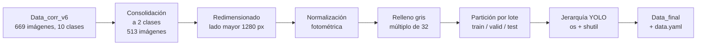
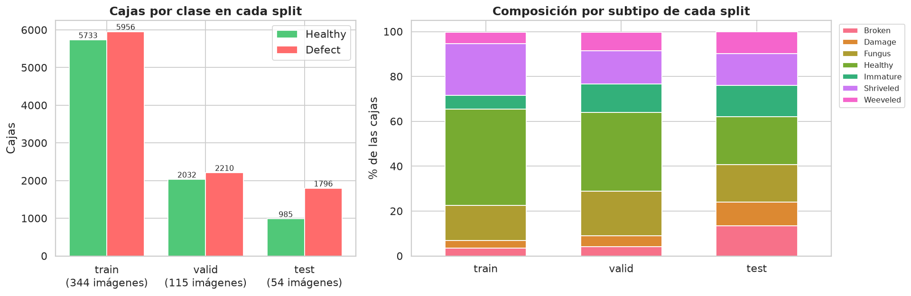
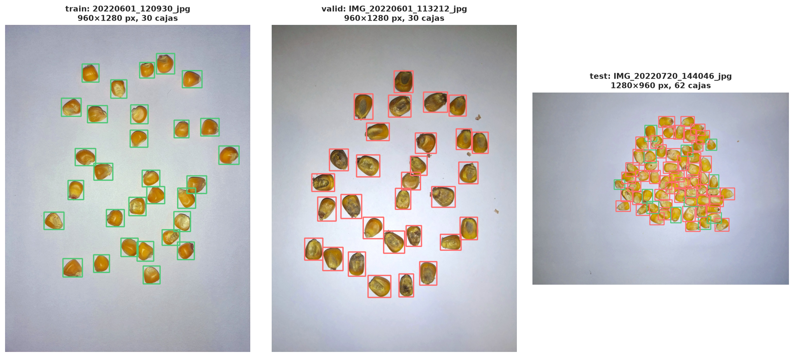

# Informe 1.3: Estructuración del Conjunto de Datos

| | | | |
| :--- | :--- | :--- | :--- |
| **Proyecto:** | Detección de defectos en granos de maíz con YOLOv11 | **Fecha:** | 28 - 10 - 2026 |
| **Objetivo:** | Objetivo Específico 1, Actividad 1.3 | **Notebook:** | `1.3_estructuracion_dataset.ipynb` |
| **Resultado:** | `datos/Data_final` (513 imágenes, 18 712 cajas) | **Figuras:** | `salida/1.3_estructuracion/` |

---

## 1. Planteamiento

Según el PIIC, esta actividad aplica de forma definitiva las técnicas de ingeniería validadas en la Actividad 1.2 y formatea la información:
- partición final de las imágenes y sus etiquetas en entrenamiento, validación y prueba;
- organización de las carpetas en la jerarquía que exige YOLO, con Python y sus librerías de sistema (`os`, `shutil`).

**Entregables:**
- **Pipeline de preprocesamiento en código:** la función `pipeline_dataset_final` de `comun.py`, y `preprocesar` para las imágenes nuevas.
- **Dataset final estructurado:** `datos/Data_final`, listo para los modelos del OE2.

## 2. Configuración aplicada

| Transformación | Aplicación en el dataset final |
| :--- | :--- |
| Limpieza de etiquetas | Etiquetas corregidas de `Data_corr_v6` (informe 1.2, limpieza) |
| Consolidación a 2 clases | `Healthy` + `Immature` → **Healthy**; `Broken`, `Damage`, `Fungus`, `Shriveled`, `Weeveled` → **Defect**; sin impurezas ni otras semillas |
| Estandarización geométrica | Letterbox a **1280 px** (lado mayor), relleno gris (114, 114, 114) hasta múltiplo de 32 |
| Normalización fotométrica | **Sí** (`norm`): Gray World, brillo, contraste y saturación, sobre la imagen redimensionada y antes del relleno |
| Balanceo de clases | **No** |
| Normalización de píxeles a [0, 1] | En el dataloader de Ultralytics, al entrenar |
| Aumento de datos | En línea, por defecto de Ultralytics, al entrenar |

La resolución, la normalización fotométrica y el balanceo salen del experimento de la Actividad 1.2 (`resultados/decision.json`, informe 1.2, sección 9.4).

## 3. Pipeline de preprocesamiento



`pipeline_dataset_final` ejecuta todos los pasos a partir de las etiquetas corregidas. La configuración se lee de `decision.json`: si se hubiera elegido el balanceo, el pipeline también lo aplicaría al entrenamiento. La normalización se aplica antes del relleno, para que el gris del relleno no altere sus estadísticas de color. Los archivos del dataset final son idénticos byte a byte a los usados en el experimento de la Actividad 1.2.

## 4. Partición final

Se conserva la partición por lote de captura de la Actividad 1.2, sin fuga entre conjuntos:
- **Prueba:** el test fijo, que no se usó en ninguna decisión.
- **Validación:** uno de los 4 pliegues de la validación cruzada.
- **Entrenamiento:** los otros 3 pliegues.

**Elección del pliegue de validación.** Entre los pliegues que tienen entre el 15 y el 25 % de las imágenes, se elige el de composición por subtipo más parecida a la del conjunto de desarrollo. El criterio solo usa etiquetas, no resultados de entrenamiento.

| Pliegue | Imágenes | % del total | Diferencia máxima por subtipo (puntos porcentuales) |
| :---: | :---: | :---: | :---: |
| 0 | 120 | 23.4 | 8.32 |
| 1 | 120 | 23.4 | 9.33 |
| **2** | **115** | **22.4** | **6.09** |
| 3 | 104 | 20.3 | 15.74 |

| Split | Imágenes | % | Lotes | Cajas | Healthy | Defect | % Healthy |
| :--- | :---: | :---: | :---: | :---: | :---: | :---: | :---: |
| Entrenamiento (`train`) | 344 | 67.1 | 7 | 11 689 | 5 733 | 5 956 | 49.0 |
| Validación (`valid`) | 115 | 22.4 | 7 | 4 242 | 2 032 | 2 210 | 47.9 |
| Prueba (`test`) | 54 | 10.5 | 5 | 2 781 | 985 | 1 796 | 35.4 |
| **Total** | **513** | **100** | **19** | **18 712** | **8 750** | **9 962** | **46.8** |

*Healthy incluye `Immature`.*

Todos los subtipos están presentes en cada split. Entrenamiento y validación están cerca del equilibrio entre clases. El test tiene más defectos (64.6 % de las cajas), sobre todo `Broken` y `Damage`, por la composición de sus 5 lotes; conviene tenerlo en cuenta al comparar las métricas de validación y de prueba en el OE2.



## 5. Estructura del dataset

```
Data_final/
├── data.yaml
├── train/
│   ├── images/           344 imágenes (.jpg)
│   ├── labels/           344 etiquetas YOLO (clase binaria)
│   └── labels_subtipo/   344 etiquetas con el subtipo original
├── valid/                115 imágenes, con las mismas tres carpetas
└── test/                  54 imágenes, con las mismas tres carpetas
```

```yaml
train: train/images
val: valid/images
test: test/images
nc: 2
names: ["Healthy", "Defect"]
```

- **`labels/`:** una línea por grano, `clase cx cy ancho alto`, con coordenadas normalizadas entre 0 y 1; clase 0 = `Healthy` y 1 = `Defect`.
- **`labels_subtipo/`:** las mismas cajas, en el mismo orden, con el subtipo original (`Broken`, `Fungus`, etc.). YOLO no la lee; sirve para medir el acierto por subtipo en el OE2.
- **`data.yaml`:** usa rutas relativas a su propia carpeta, así que el dataset funciona en cualquier equipo sin editarlo.

## 6. Verificaciones

| Verificación | Resultado | Detalle |
| :--- | :---: | :--- |
| Imágenes por split según la partición | OK | train 344, valid 115, test 54 |
| Cada imagen tiene su etiqueta y su etiqueta de subtipo, y viceversa | OK | |
| Ninguna imagen en dos splits | OK | 513 imágenes únicas |
| Ningún lote de captura en dos splits (sin fuga) | OK | train 7 lotes, valid 7, test 5 |
| Formato YOLO: 5 valores, clase 0 o 1, coordenadas normalizadas | OK | 18 712 cajas, 0 con error |
| Lado mayor de 1280 px y ambos lados múltiplos de 32 | OK | 960 × 1280 (468), 1280 × 960 (35), 1280 × 864 (7), 864 × 1280 (3) |
| Archivos idénticos a los generados en la Actividad 1.2 | OK | |
| Entrenamiento y validación idénticos al paquete con el que se entrenó en la nube | OK | 918 archivos |
| `preprocesar` reproduce las imágenes del dataset desde las fotos originales | OK | 15 imágenes (5 por split), bytes idénticos |
| `data.yaml` válido para Ultralytics | OK | 2 clases: `Healthy`, `Defect` |



## 7. Uso en el OE2

- **Paquete:** `nube/oe1_dataset_final.zip` (169 MB) contiene `Data_final` completo. A 1280 px con lote 8, el entrenamiento necesita unos 11 GB de VRAM, más que la GPU local (6 GB), así que se ejecuta en la nube.
- **Entrenamiento:** `model.train(data='Data_final/data.yaml', imgsz=1280, ...)`.
- **Uso de los splits:** el ajuste de hiperparámetros del OE2 se evalúa en `valid`. El `test` se reserva para la evaluación comparativa final de YOLOv11n y YOLOv11s.
- **Imágenes nuevas:** como el dataset está normalizado fotométricamente, toda imagen que no venga de él (fotos propias, aplicación) debe pasar antes por el mismo preprocesamiento: `comun.preprocesar(img, 1280, 'norm')`. Devuelve la imagen lista para el modelo, la escala y el desplazamiento del relleno, para llevar coordenadas entre la imagen original y la preprocesada. La verificación de la sección 6 comprueba que reproduce exactamente las imágenes del dataset.
