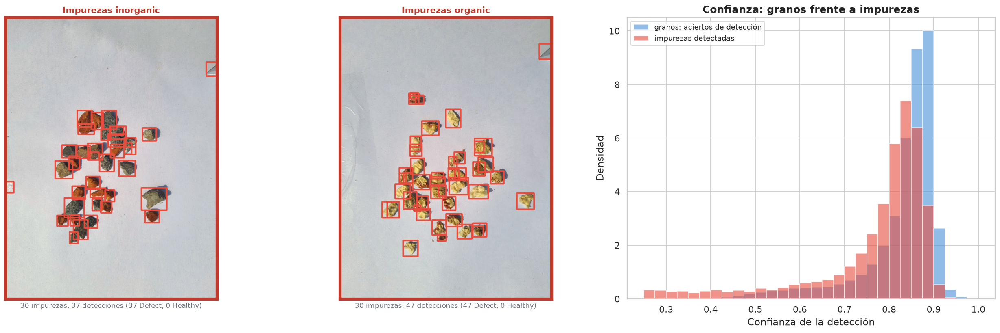
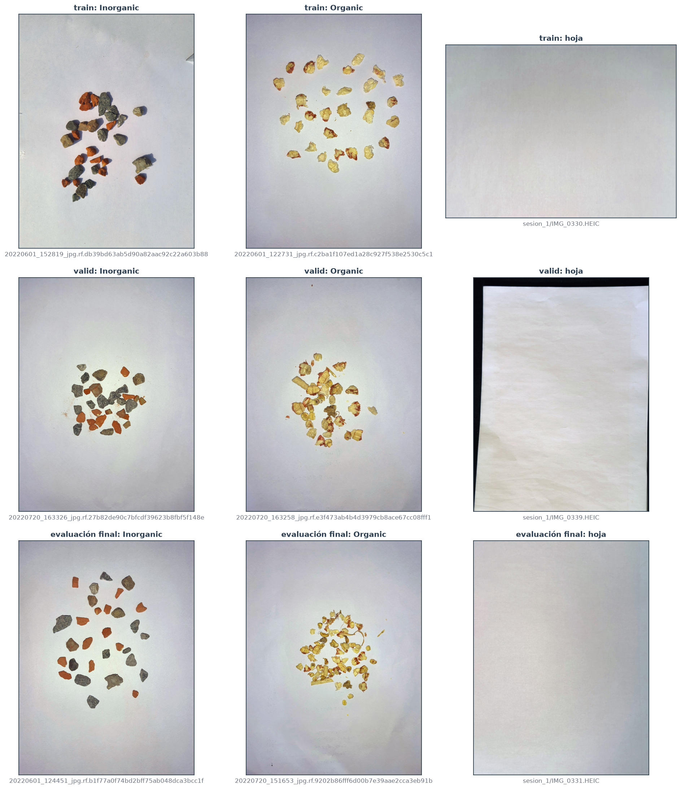
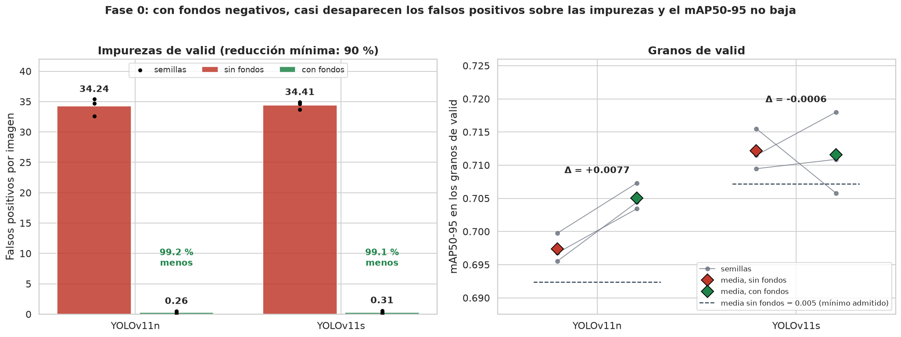
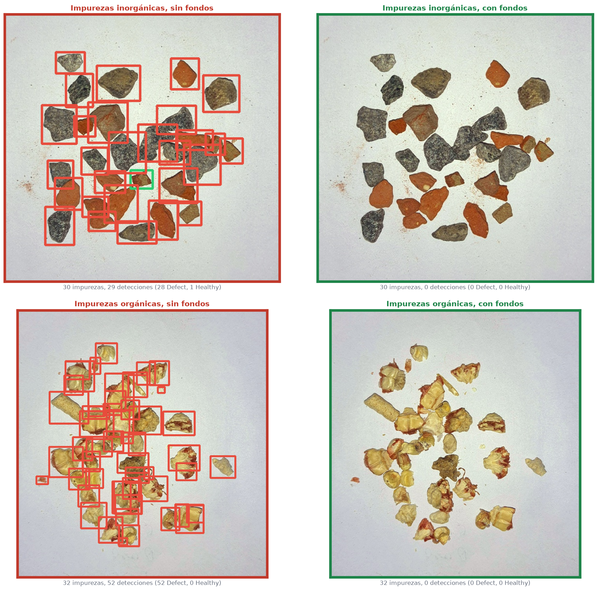
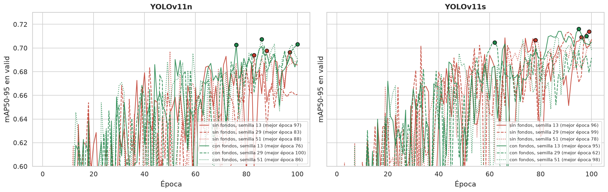
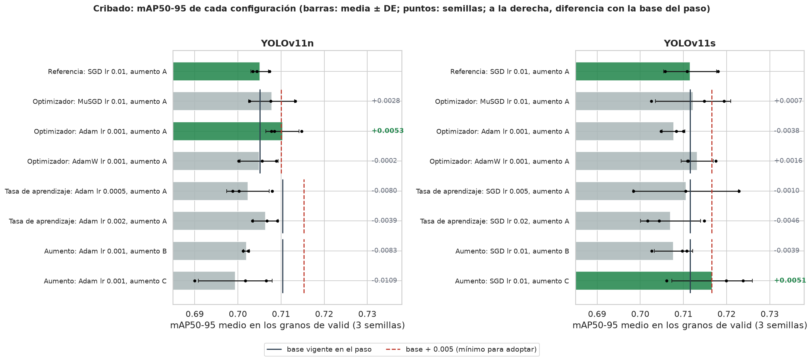
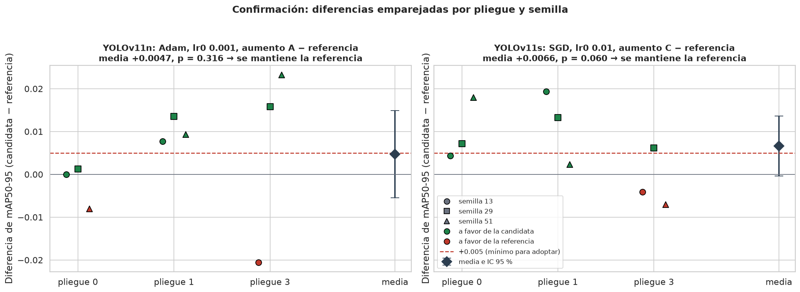
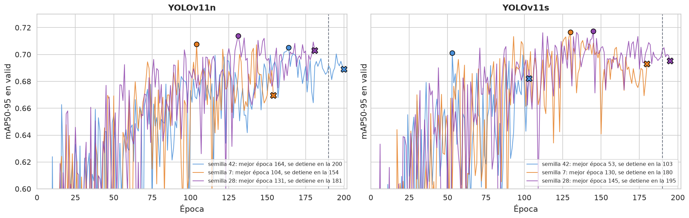

# Informe 2.2: Entrenamiento y Ajuste de Hiperparámetros

| | | | |
| :--- | :--- | :--- | :--- |
| **Proyecto:** | Detección de defectos en granos de maíz con YOLOv11 | **Fecha:** | 28 - 10 - 2026 |
| **Objetivo:** | Objetivo Específico 2, Actividad 2.2 | **Notebooks:** | `2.2a_fondos_dataset.ipynb`, `nube/2.2_entrenamiento_colab.ipynb`, `2.2_entrenamiento.ipynb` |
| **Datos:** | `datos/Data_final` y `datos/fondos` | **Figuras:** | `salida/2.2a_fondos/`, `salida/2.2_entrenamiento/` |
| **Registro:** | `resultados/experimentos/<fase>.csv`, `resultados/decision_*.json`, `resultados/configuracion_final.json` | **Corridas:** | `runs/oe2/` |

---

## 1. Planteamiento

La actividad entrena YOLOv11n y YOLOv11s y ajusta sus hiperparámetros en cuatro fases, con las reglas fijadas antes de entrenar en `plan_oe2.md`:

1. **Fondos negativos:** decide si el entrenamiento incluye imágenes sin granos.
2. **Cribado:** optimizador, tasa de aprendizaje y aumento en línea, en `train` / `valid`.
3. **Confirmación:** la ganadora del cribado frente a la referencia, en validación cruzada (pliegues 0, 1 y 3; solo si hace falta).
4. **Entrenamiento final:** la configuración adoptada, con otras semillas y más épocas.

## 2. Evidencia: modelos entrenados solo con granos frente a impurezas

Antes de construir los fondos se comprobó si el problema existe, sin entrenar y sin usar el test. Se evaluaron los 12 modelos del OE1 con la configuración elegida (YOLOv11s, 1280 px, `norm`, sin balanceo; 4 pliegues × 3 semillas), entrenados solo con granos:
- cada modelo, con **las impurezas de los lotes de su pliegue de validación**, de sesiones que no vio al entrenar (114 imágenes en total);
- con **15 hojas** que no forman parte de la evaluación final;
- con **los granos de su pliegue de validación**, como referencia para la confianza.

Umbral de 0.25 y NMS agnóstico. Las impurezas de los lotes del test y las hojas de evaluación se reservan para la evaluación final.

| Fondo | Imágenes por modelo | Detecciones por imagen | Impurezas detectadas como grano | Detecciones como `Defect` |
| :--- | :---: | :---: | :---: | :---: |
| Impurezas inorgánicas | 13 | **36.7** ± 10.2 | **98.5 %** | 99.5 % |
| Impurezas orgánicas | 15.5 | **37.0** ± 5.1 | **96.0 %** | 99.9 % |
| Hojas vacías | 15 | 0.02 ± 0.06 | — | — |

*Media de los 12 modelos ± desviación estándar entre modelos. Una impureza está detectada como grano si una detección la cubre con IoU ≥ 0.5.*

| Umbral de confianza | Aciertos de grano que se conservan | Detecciones de impurezas que se conservan |
| :---: | :---: | :---: |
| 0.25 | 100 % | 100 % |
| 0.50 | 98.9 % | 92.7 % |
| 0.70 | 91.0 % | 81.4 % |
| 0.80 | 78.8 % | 59.1 % |

- **Los modelos entrenados solo con granos detectan casi todas las impurezas como granos**, y casi siempre como `Defect`: de 96 a 99 % de las impurezas, con unas 37 detecciones por imagen. En una muestra real, cada impureza sumaría un grano defectuoso al conteo.
- **El umbral de confianza no las separa.** Las confianzas de las impurezas se solapan con las de los granos: con un umbral de 0.80 se perdería el 21 % de los granos y aún quedaría el 59 % de las detecciones de impurezas.
- **Las hojas vacías casi no generan falsos positivos.** El problema son los objetos que se parecen a un grano, no el papel. Las hojas se incluyen de todos modos entre los fondos, porque representan variaciones del papel y del encuadre que el dataset no tiene: otra iluminación y el borde de la mesa.

Esto motiva la fase 0: enseñar a los modelos, con fondos negativos, que las impurezas no son granos.

## 3. Fondos negativos: dataset

`Data_final` solo contiene granos. En una muestra real aparecen también impurezas y el papel de fondo. Los **fondos negativos**, imágenes sin granos con la etiqueta vacía, enseñan a la red qué no es un grano.

### 3.1. Fuentes

- **Impurezas:** las 144 fotos de `Data_corr_v6` que solo contienen impurezas inorgánicas (76) u orgánicas (68). Se retiraron del dataset en el OE1 y ningún modelo las ha visto. Las otras semillas no se usan: la clase se descartó en el OE1 por salir del objetivo.
- **Hojas vacías:** 25 fotos del papel sin granos, en dos sesiones con distinta iluminación y encuadre; algunas muestran el borde de la mesa. Sus metadatos (ubicación, fecha y dispositivo) se eliminaron.

### 3.2. Reglas

1. **Mismo preprocesamiento que el dataset:** letterbox a 1280 px y normalización fotométrica (`comun.preprocesar`).
2. **Sin fuga por lote de captura:** las impurezas se fotografiaron en las mismas sesiones que los granos. Cada una va al conjunto de su lote, calculado en el OE1 con las 669 fotos. Como ningún lote está repartido entre conjuntos, todas las impurezas tienen un único destino y no se descarta ninguna:

   | Lotes de las impurezas | Destino | Inorgánicas | Orgánicas | Lotes |
   | :--- | :--- | :---: | :---: | :---: |
   | Pliegues 0, 1 y 3 (`train`) | Candidatas a entrenamiento | 48 | 48 | 5 |
   | Pliegue 2 (`valid`) | Medición de falsos positivos | 4 | 14 | 2 |
   | Test | Evaluación final (2.3) | 24 | 6 | 3 |

3. **Proporción:** los fondos de entrenamiento son el 10 % de las imágenes de entrenamiento, el máximo que recomienda la documentación de Ultralytics (*Tips for Best Training Results*: 0-10 % de fondos). Se reparten entre hojas e impurezas, mitad inorgánicas y mitad orgánicas, tomando una impureza por lote por turnos para cubrir el mayor número de lotes.
4. **Hojas:** no contienen objetos, así que se reparten por imagen: de cada sesión, la mitad a entrenamiento, un 15 % a medición y el resto a la evaluación final.
5. **Medición:** las impurezas y hojas de `valid` no se entrenan ni entran en el mAP50-95; sirven para contar los falsos positivos. La validación usa siempre solo granos, para que el mAP50-95 sea comparable con y sin fondos.

Las mismas reglas se aplican a cada pliegue de la validación cruzada, para la fase de confirmación.

### 3.3. Resultado

| Partición | Granos de entrenamiento | Fondos de entrenamiento | Hojas | Inorgánicas | Orgánicas | Fracción de fondos | Impurezas de medición | Hojas de medición |
| :--- | :---: | :---: | :---: | :---: | :---: | :---: | :---: | :---: |
| **`valid`** (y entrenamiento final) | 344 | 38 | 12 | 13 | 13 | 9.9 % | 18 | 3 |
| Pliegue 0 | 339 | 38 | 12 | 13 | 13 | 10.1 % | 34 | 3 |
| Pliegue 1 | 339 | 38 | 12 | 13 | 13 | 10.1 % | 35 | 3 |
| Pliegue 2 | 344 | 38 | 12 | 13 | 13 | 9.9 % | 18 | 3 |
| Pliegue 3 | 355 | 39 | 12 | 14 | 13 | 9.9 % | 27 | 3 |

La evaluación final dispone de 30 impurezas de los lotes del test y 10 hojas, con las cajas de cada impureza para medir qué fracción se detecta como grano.

**Verificaciones:** todas las imágenes tienen el lado mayor de 1280 px y ambos lados múltiplos de 32; las etiquetas de entrenamiento están vacías; ninguna impureza de los lotes del test sale de la evaluación final; ningún fondo de entrenamiento comparte lote con la validación de su partición; y Ultralytics lee los fondos como imágenes sin cajas.

## 4. Fase 0: fondos negativos

La configuración de referencia (SGD, `lr0 = 0.01`, lote 16, aumento A, 100 épocas) se entrenó con y sin los 38 fondos de entrenamiento, en `train` / `valid`, con los dos modelos y las semillas 13, 29 y 51: 12 corridas en la A100 de Colab, 1.8 h en total. Cada corrida se evaluó en los granos de `valid` y contó sus detecciones sobre los fondos de medición de `valid` (18 impurezas de lotes que no se entrenan y 3 hojas), con el umbral de 0.25 y NMS agnóstico. Toda detección sobre un fondo es un falso positivo.

Las 12 corridas entrenaron con los argumentos de su registro y con el dataset de su versión. La inferencia repetida en local reproduce los falsos positivos registrados en Colab: como mucho, una detección de diferencia en una corrida, según el hardware.

### 4.1. Decisión

| Modelo | Versión | mAP50-95 en los granos de `valid` | Falsos positivos por imagen: impurezas | Falsos positivos por imagen: hojas |
| :--- | :--- | :---: | :---: | :---: |
| YOLOv11n | sin fondos | 0.6974 ± 0.0022 | 34.24 | 0.11 |
| | con fondos | **0.7051** ± 0.0020 | **0.26** | 0 |
| YOLOv11s | sin fondos | 0.7122 ± 0.0031 | 34.41 | 0 |
| | con fondos | **0.7116** ± 0.0061 | **0.31** | 0.11 |

*Media ± desviación estándar de las 3 semillas.*

| Modelo | Reducción de los falsos positivos sobre las impurezas (mínimo 90 %) | Diferencia de mAP50-95 (mínimo −0.005) | Cumple |
| :--- | :---: | :---: | :---: |
| YOLOv11n | 99.2 % | +0.0077 | Sí |
| YOLOv11s | 99.1 % | −0.0006 | Sí |

**Decisión: se adoptan los fondos negativos.** Se cumplen las dos condiciones en los dos modelos.

- **Los falsos positivos sobre las impurezas casi desaparecen:** pasan de unos 34 por imagen a menos de 0.4, en las 3 semillas de los dos modelos.
- **El mAP50-95 en los granos no baja:**
  - **YOLOv11n** mejora en las 3 semillas (de +0.007 a +0.009);
  - **YOLOv11s** cambia en ambos sentidos (de −0.010 a +0.007), dentro de la variación entre semillas.

### 4.2. Falsos positivos por tipo de fondo

| Fondo de `valid` | Imágenes | Detecciones por imagen: YOLOv11n | Detecciones por imagen: YOLOv11s | Impurezas detectadas como grano: YOLOv11n | Impurezas detectadas como grano: YOLOv11s |
| :--- | :---: | :---: | :---: | :---: | :---: |
| Impurezas inorgánicas | 4 | 31.0 → **0** | 30.6 → **0** | 98.9 % → **0 %** | 98.9 % → **0 %** |
| Impurezas orgánicas | 14 | 35.2 → **0.33** | 35.5 → **0.40** | 99.6 % → **1.1 %** | 99.5 % → **1.2 %** |
| Hojas | 3 | 0.11 → 0 | 0 → 0.11 | — | — |

*Sin fondos → con fondos; media de las 3 semillas. Una impureza está detectada como grano si una detección la cubre con IoU ≥ 0.5.*

- **Sin fondos se reproduce el problema de la sección 2:** el 99 % de las impurezas se detecta como grano, y del 92 al 100 % de esas detecciones son `Defect`.
- **Con fondos, ninguna impureza inorgánica se detecta.** En las orgánicas, que se parecen más a un grano, quedan 31 detecciones entre las 6 corridas, en 5 de las 14 imágenes: alrededor del 1 % de las impurezas.
- **El efecto se mantiene en sesiones nuevas:** las 18 impurezas de medición son de lotes de captura que ningún modelo vio al entrenar.
- **Las hojas no son un problema en ninguna versión:** una detección en una de las 3 hojas, en una corrida de cada versión.
- **Limitación:** `valid` solo tiene 4 imágenes de impurezas inorgánicas. La evaluación final (2.3) lo comprueba con las 30 impurezas de los lotes del test, 24 de ellas inorgánicas.

### 4.3. Efecto en los granos de `valid`

| Métrica | YOLOv11n: sin fondos | YOLOv11n: con fondos | YOLOv11n: diferencia | YOLOv11s: sin fondos | YOLOv11s: con fondos | YOLOv11s: diferencia |
| :--- | :---: | :---: | :---: | :---: | :---: | :---: |
| mAP50-95 | 0.6974 | 0.7051 | +0.0077 (3/3) | 0.7122 | 0.7116 | −0.0006 (2/3) |
| mAP50 | 0.9469 | 0.9574 | +0.0105 (3/3) | 0.9496 | 0.9552 | +0.0056 (2/3) |
| mAP75 | 0.8397 | 0.8457 | +0.0060 (3/3) | 0.8490 | 0.8391 | −0.0100 (1/3) |
| Precisión | 0.8142 | 0.8599 | +0.0457 (3/3) | 0.8364 | 0.8265 | −0.0099 (1/3) |
| Recall | 0.9169 | 0.8975 | −0.0194 (1/3) | 0.8988 | 0.9250 | +0.0262 (3/3) |
| AP50-95 `Healthy` | 0.6931 | 0.6956 | +0.0025 (1/3) | 0.6981 | 0.6969 | −0.0012 (1/3) |
| AP50-95 `Defect` | 0.7016 | 0.7146 | +0.0129 (2/3) | 0.7262 | 0.7262 | 0.0000 (2/3) |
| F1 máximo | 0.8582 | 0.8765 | +0.0183 (3/3) | 0.8653 | 0.8699 | +0.0046 (2/3) |
| MAE de conteo | 0.733 | 0.615 | −0.119 (3/3) | 0.617 | 0.600 | −0.017 (1/3) |

*Media de las 3 semillas; diferencia con − sin, emparejada por semilla. Entre paréntesis, en cuántas semillas mejora; en el MAE, mejorar es bajar. La precisión y el recall son los de Ultralytics, al umbral de máximo F1; el MAE de conteo, al umbral de 0.25.*

- **Los fondos no enseñan a ignorar granos:** los granos de `valid` sin detectar siguen siendo el 0.2-0.3 % en las dos versiones.
- **En YOLOv11n**, con fondos mejoran en las 3 semillas el mAP50-95, el mAP50, el mAP75, la precisión, el F1 y el MAE de conteo. La mejora del mAP50-95 viene sobre todo de `Defect` (+0.013).
- **En YOLOv11s**, las diferencias van en ambos sentidos y son del orden de la variación entre semillas.
- **Casi todos los errores en los granos son de clase:** el 98 % son granos detectados con la clase cambiada (`Healthy` ↔ `Defect`).
- **El acierto por subtipo varía más entre semillas que entre versiones**, sobre todo en los subtipos sutiles. Por ejemplo, la corrida de YOLOv11s con fondos y semilla 29 acierta el 36 % de los granos `Immature`: clasifica 341 de los 541 como `Defect` (en la consolidación del OE1, `Immature` pertenece a `Healthy`). Las otras semillas aciertan del 82 al 87 %. Es también la corrida de YOLOv11s con el mAP50-95 más bajo (0.7058). La frontera entre `Healthy` y `Defect` en estos subtipos se analiza en el diagnóstico de los modelos finales.

### 4.4. Convergencia y costo

- **Mejor época, de 62 a 100:** en 6 de las 12 corridas cae en las últimas 10 épocas, en las que Ultralytics desactiva el mosaico (`close_mosaic = 10`). Hasta entonces, el mAP50-95 oscila mucho de una época a otra.
- **El presupuesto de 100 épocas basta para comparar:** todas las configuraciones del cribado lo comparten. El entrenamiento final usa 200 épocas con `patience = 50` (`plan_oe2.md`), para que las curvas puedan estabilizarse.
- **Costo por corrida:** de 8 a 9.5 minutos. La memoria reservada máxima fue de 15 a 18 GB con YOLOv11n y de 24 GB con YOLOv11s, dentro de los 40 GB de la A100. Los fondos añaden un 10 % de imágenes y alrededor de medio minuto por corrida.

### 4.5. Consecuencias para las fases siguientes

- El cribado, la confirmación y el entrenamiento final entrenan con los fondos de su partición.
- La referencia del cribado son las 3 corridas con fondos de cada modelo: mAP50-95 de 0.7051 en YOLOv11n y de 0.7116 en YOLOv11s. No se repiten.

## 5. Cribado

Por modelo, en `train` / `valid` y con los fondos adoptados. Los factores se probaron en orden, cada uno sobre la base vigente:
1. el optimizador, con su tasa estándar;
2. la tasa de aprendizaje, ×0.5 y ×2;
3. el aumento en línea, B y C.

Cada configuración se entrenó con las semillas 13, 29 y 51. Una alternativa pasa a ser la base si supera a la base vigente en al menos +0.005 de mAP50-95 medio en los granos de `valid`. La referencia son las corridas con fondos de la fase 0. En total, 42 corridas (21 por modelo) y 8.1 h en la A100.

### 5.1. Resultados

**YOLOv11n**

| Paso | Configuración | mAP50-95 | Semillas 13 / 29 / 51 | Diferencia con la base | |
| :--- | :--- | :---: | :---: | :---: | :---: |
| Referencia | SGD, `lr0` 0.01, aumento A | 0.7051 ± 0.0020 | 0.7034 / 0.7044 / 0.7073 | — | base |
| Optimizador | MuSGD, `lr0` 0.01 | 0.7078 ± 0.0053 | 0.7076 / 0.7133 / 0.7027 | +0.0028 | |
| | **Adam, `lr0` 0.001** | **0.7103** ± 0.0039 | 0.7148 / 0.7078 / 0.7084 | **+0.0053** | **nueva base** |
| | AdamW, `lr0` 0.001 | 0.7049 ± 0.0044 | 0.7002 / 0.7089 / 0.7056 | −0.0002 | |
| Tasa de aprendizaje | Adam, `lr0` 0.0005 | 0.7023 ± 0.0049 | 0.7003 / 0.6987 / 0.7080 | −0.0080 | |
| | Adam, `lr0` 0.002 | 0.7064 ± 0.0029 | 0.7092 / 0.7067 / 0.7034 | −0.0039 | |
| Aumento | Adam, `lr0` 0.001, aumento B | 0.7020 ± 0.0007 | 0.7012 / 0.7024 / 0.7024 | −0.0083 | |
| | Adam, `lr0` 0.001, aumento C | 0.6994 ± 0.0085 | 0.6900 / 0.7017 / 0.7066 | −0.0109 | |

**YOLOv11s**

| Paso | Configuración | mAP50-95 | Semillas 13 / 29 / 51 | Diferencia con la base | |
| :--- | :--- | :---: | :---: | :---: | :---: |
| Referencia | SGD, `lr0` 0.01, aumento A | 0.7116 ± 0.0061 | 0.7180 / 0.7058 / 0.7109 | — | base |
| Optimizador | MuSGD, `lr0` 0.01 | 0.7123 ± 0.0087 | 0.7149 / 0.7025 / 0.7194 | +0.0007 | |
| | Adam, `lr0` 0.001 | 0.7077 ± 0.0026 | 0.7083 / 0.7100 / 0.7048 | −0.0038 | |
| | AdamW, `lr0` 0.001 | 0.7132 ± 0.0037 | 0.7111 / 0.7109 / 0.7175 | +0.0016 | |
| Tasa de aprendizaje | SGD, `lr0` 0.005 | 0.7106 ± 0.0122 | 0.7228 / 0.6984 / 0.7105 | −0.0010 | |
| | SGD, `lr0` 0.02 | 0.7070 ± 0.0070 | 0.7149 / 0.7044 / 0.7017 | −0.0046 | |
| Aumento | SGD, `lr0` 0.01, aumento B | 0.7077 ± 0.0044 | 0.7108 / 0.7026 / 0.7097 | −0.0039 | |
| | **SGD, `lr0` 0.01, aumento C** | **0.7166** ± 0.0093 | 0.7200 / 0.7238 / 0.7061 | **+0.0051** | **nueva base** |

*mAP50-95 en los granos de `valid`: media ± desviación estándar de las 3 semillas. La diferencia es con la base vigente en cada paso.*

**Ganadoras del cribado** (`resultados/decision_cribado.json`):
- **YOLOv11n: Adam, `lr0 = 0.001`, aumento A.**
- **YOLOv11s: SGD, `lr0 = 0.01`, aumento C.**

Ninguna es la referencia, así que las dos pasan a la confirmación.

### 5.2. Análisis

- **Las dos ganadoras superan el umbral por muy poco** (+0.0053 y +0.0051), con márgenes del orden de la variación entre semillas:
  - Adam supera a SGD en las 3 semillas de YOLOv11n (+0.0114, +0.0034 y +0.0011);
  - el aumento C supera a la referencia en 2 de las 3 semillas de YOLOv11s (+0.0020, +0.0180 y −0.0048).

  Es el caso que la regla de confirmación está para resolver: más comparaciones emparejadas, en otros pliegues, y una prueba de significación.
- **La tasa de aprendizaje estándar es adecuada:** ni ×0.5 ni ×2 mejoran en ningún modelo.
- **El aumento afecta distinto a cada modelo:**
  - en YOLOv11n, B y C bajan el mAP50-95 (−0.008 y −0.011);
  - en YOLOv11s, C lo sube y B no.

  Es coherente con que el modelo de mayor capacidad aproveche un aumento más fuerte (C añade volteo vertical y giros de 90°); la confirmación dirá si el efecto se sostiene.

| Configuración | mAP50 | Precisión | Recall | F1 máximo | MAE de conteo | Falsos positivos por imagen: impurezas | Minutos por corrida |
| :--- | :---: | :---: | :---: | :---: | :---: | :---: | :---: |
| YOLOv11n, referencia | 0.957 | 0.860 | 0.897 | 0.876 | 0.61 | 0.26 | 8.9 |
| YOLOv11n, ganadora (Adam) | 0.960 | 0.845 | 0.923 | 0.878 | 0.77 | 0.09 | 8.9 |
| YOLOv11s, referencia | 0.955 | 0.826 | 0.925 | 0.870 | 0.60 | 0.31 | 9.3 |
| YOLOv11s, ganadora (aumento C) | 0.956 | 0.845 | 0.911 | 0.873 | 0.70 | 0.28 | 17.8 |

*Media de las 3 semillas. El MAE de conteo es al umbral fijo de 0.25.*

- **Las ganadoras mantienen el efecto de los fondos:** 0.09 y 0.28 falsos positivos por imagen sobre las impurezas. En cambio, algunas alternativas descartadas los aumentan, por ejemplo:
  - el aumento C en YOLOv11n: 6.6;
  - `lr0` ×2: 1.4 en YOLOv11n y 2.9 en YOLOv11s.
- **El MAE de conteo al umbral fijo de 0.25 sube en las ganadoras**, porque cambia la calibración de la confianza: el umbral de máximo F1 de YOLOv11n baja de 0.46 con SGD a 0.38 con Adam. El entrenamiento final fija el umbral de conteo en el máximo F1 de cada modelo, así que este MAE no es el del uso final.
- **Costo:** los aumentos B y C duplican el tiempo por corrida (17-18 min frente a 9), por las transformaciones de Albumentations, que se ejecutan en la CPU.

### 5.3. Diseño de la confirmación

La confirmación compara cada ganadora con la referencia en los **pliegues 0, 1 y 3** de la validación cruzada del OE1, con las semillas 13, 29 y 51: 9 comparaciones emparejadas por pliegue y semilla, con la regla de `plan_oe2.md` (al menos +0.005 de media y p < 0.05, t pareada).

El plan inicial preveía los 4 pliegues. El **pliegue 2 se excluye** porque su partición es idéntica a `train` / `valid`: mismas imágenes de entrenamiento en el mismo orden, mismos fondos y misma validación. Con las mismas semillas, sus 3 comparaciones repetirían las corridas del cribado con las que se eligió la ganadora, y favorecerían a la candidata. El ajuste se decidió después del cribado y antes de entrenar la confirmación. Además, ahorra 6 corridas por modelo.

## 6. Confirmación

Cada ganadora del cribado se comparó con la referencia (SGD, `lr0 = 0.01`, aumento A, con fondos) en los pliegues 0, 1 y 3 de la validación cruzada, con las semillas 13, 29 y 51. Cada corrida entrenó con los otros tres pliegues y los fondos de su partición, y se evaluó en los granos de su pliegue. En total, 36 corridas (18 por modelo) y 6.5 h en la A100.

### 6.1. Decisión

| Modelo | Candidata | mAP50-95 referencia | mAP50-95 candidata | Diferencia media (IC 95 %) | Valor p | A favor | Decisión |
| :--- | :--- | :---: | :---: | :---: | :---: | :---: | :--- |
| YOLOv11n | Adam, `lr0` 0.001 | 0.7450 | 0.7497 | +0.0047 (−0.0055 a +0.0149) | 0.316 | 7 de 9 | **Se mantiene la referencia:** no alcanza +0.005 ni es significativa |
| YOLOv11s | SGD, `lr0` 0.01, aumento C | 0.7615 | 0.7681 | +0.0066 (−0.0004 a +0.0136) | 0.060 | 7 de 9 | **Se mantiene la referencia:** alcanza +0.005, pero no es significativa |

*mAP50-95 medio de las 9 corridas, cada una en los granos de su pliegue. Diferencia candidata − referencia, emparejada por pliegue y semilla; t pareada.*

| Pliegue | YOLOv11n, semillas 13 / 29 / 51 | YOLOv11n, media | YOLOv11s, semillas 13 / 29 / 51 | YOLOv11s, media |
| :---: | :---: | :---: | :---: | :---: |
| 0 | +0.0000 / +0.0013 / −0.0080 | −0.0022 | +0.0043 / +0.0072 / +0.0180 | +0.0099 |
| 1 | +0.0078 / +0.0135 / +0.0094 | +0.0102 | +0.0194 / +0.0133 / +0.0023 | +0.0117 |
| 3 | −0.0205 / +0.0158 / +0.0233 | +0.0062 | −0.0041 / +0.0062 / −0.0070 | −0.0016 |

*Diferencia de mAP50-95, candidata − referencia.*

- **YOLOv11n: la ventaja de Adam no se confirma.**
  - En otros pliegues, la mejora media baja a +0.0047 y cambia mucho de una semilla a otra: en el pliegue 3, va de −0.021 a +0.023.
  - La ventaja del cribado (+0.0053) se explica, al menos en parte, por haber elegido la mejor de tres alternativas en un solo pliegue.
- **YOLOv11s: el aumento C mejora en promedio, pero no de forma concluyente.**
  - La media (+0.0066) supera el mínimo y mejora en los pliegues 0 y 1, pero no en el 3 (−0.0016).
  - El intervalo de confianza incluye el cero y p = 0.060 no alcanza el nivel fijado.
  - Además, C duplica el tiempo de entrenamiento (17 min por corrida frente a 9).

  Con la regla fijada antes de entrenar, se mantiene la configuración más simple. Queda como indicio de que un aumento más fuerte podría beneficiar al modelo de mayor capacidad.
- **El mAP50-95 de la validación cruzada (0.73-0.79) es mayor que el de `valid` (0.70-0.72):** el pliegue 2, que forma `valid`, es el más difícil de los cuatro, como ya mostró el OE1.

### 6.2. Métricas secundarias

| Configuración | mAP50 | Precisión | Recall | F1 máximo | MAE de conteo | Falsos positivos por imagen: impurezas | Minutos por corrida |
| :--- | :---: | :---: | :---: | :---: | :---: | :---: | :---: |
| YOLOv11n, referencia | 0.981 | 0.960 | 0.961 | 0.959 | 0.31 | 0.65 | 8.8 |
| YOLOv11n, Adam | 0.984 | 0.959 | 0.965 | 0.961 | 0.30 | 0.10 | 8.8 |
| YOLOv11s, referencia | 0.984 | 0.962 | 0.970 | 0.965 | 0.19 | 0.32 | 9.0 |
| YOLOv11s, aumento C | 0.985 | 0.950 | 0.972 | 0.960 | 0.20 | 0.37 | 16.7 |

*Media de las 9 corridas. El MAE de conteo es al umbral de 0.25. Los falsos positivos se miden sobre las impurezas de los lotes de validación de cada pliegue: 34, 35 y 27 imágenes.*

- **Las métricas secundarias no cambian la lectura:** las diferencias son pequeñas y en ambos sentidos.
- **El efecto de los fondos se mantiene en los otros pliegues:** con impurezas de otros lotes de captura, todas las configuraciones quedan por debajo de 1 falso positivo por imagen.

## 7. Configuración adoptada

| | YOLOv11n | YOLOv11s |
| :--- | :---: | :---: |
| Optimizador | SGD | SGD |
| Tasa de aprendizaje (`lr0`) | 0.01 | 0.01 |
| Lote | 16 | 16 |
| Aumento en línea | A (por defecto de Ultralytics) | A (por defecto de Ultralytics) |
| Fondos negativos | Sí (38 imágenes, 10 %) | Sí (38 imágenes, 10 %) |
| Resolución | 1280 px | 1280 px |

*Encadenada a partir del registro con `comun_oe2.configuracion_ajustada`. Decisiones en `resultados/decision_fondos.json`, `decision_cribado.json` y `decision_confirmacion.json`.*

**Lectura del ajuste:**
- **El cambio con efecto claro es de datos:** los fondos negativos.
- **Hiperparámetros:** ningún optimizador, tasa de aprendizaje ni aumento alternativo mejora a los valores por defecto de Ultralytics de forma consistente y significativa, en ninguno de los dos modelos.
- **Esfuerzo de ajuste:** fase 0, cribado y confirmación sumaron 90 corridas y 16.4 h en la A100.

**Entrenamiento final:** esta configuración, con las semillas 42, 7 y 28, 200 épocas y `patience = 50`, en `train` con `valid` como seguimiento: 6 corridas.

## 8. Entrenamiento final

Cada modelo se entrenó con su configuración adoptada y las semillas 42, 7 y 28, distintas de las de selección. Se usó `train` con los fondos y `valid` como seguimiento, hasta 200 épocas con `patience = 50`. `best.pt` es la época de mayor mAP50-95 en los granos de `valid`. En total, 6 corridas y 1.4 h en la A100. Con esto, el OE2 suma 96 corridas y 17.8 h de entrenamiento.

### 8.1. Métricas en `valid`

| Modelo | Semilla | mAP50-95 | mAP50 | mAP75 | Precisión | Recall | Umbral de máximo F1 | Épocas (mejor) |
| :--- | :---: | :---: | :---: | :---: | :---: | :---: | :---: | :---: |
| YOLOv11n | 42 | 0.7067 | 0.9572 | 0.8474 | 0.874 | 0.882 | 0.52 | 200 (164) |
| | 7 | 0.7083 | 0.9575 | 0.8472 | 0.816 | 0.932 | 0.35 | 154 (104) |
| | 28 | 0.7153 | 0.9535 | 0.8559 | 0.858 | 0.899 | 0.48 | 181 (131) |
| | **Media ± DE** | **0.7101 ± 0.0046** | 0.9560 ± 0.0022 | 0.8502 ± 0.0050 | 0.849 ± 0.030 | 0.904 ± 0.025 | | |
| YOLOv11s | 42 | 0.7018 | 0.9500 | 0.8408 | 0.775 | 0.937 | 0.13 | 103 (53) |
| | 7 | 0.7171 | 0.9489 | 0.8599 | 0.808 | 0.916 | 0.29 | 180 (130) |
| | 28 | 0.7200 | 0.9573 | 0.8521 | 0.854 | 0.911 | 0.43 | 195 (145) |
| | **Media ± DE** | **0.7129 ± 0.0098** | 0.9521 ± 0.0045 | 0.8509 ± 0.0096 | 0.812 ± 0.040 | 0.921 ± 0.014 | | |

*AP50-95 por clase (media): `Healthy` 0.706 y `Defect` 0.714 en YOLOv11n; `Healthy` 0.706 y `Defect` 0.720 en YOLOv11s.*

### 8.2. Umbral de conteo y métricas de aplicación

El umbral de conteo de cada modelo es la mediana, entre semillas, del umbral de máximo F1 en `valid`:
- **YOLOv11n: 0.48** (de 0.35, 0.48 y 0.52);
- **YOLOv11s: 0.29** (de 0.13, 0.29 y 0.43).

Quedan fijados en `resultados/configuracion_final.json` para el diagnóstico, las fotos propias y la evaluación final. Con ese umbral común:

| Métrica en `valid` | YOLOv11n | YOLOv11s |
| :--- | :---: | :---: |
| MAE de conteo (granos por imagen) | **0.46** ± 0.10 | 0.70 ± 0.06 |
| Falsos positivos por imagen: impurezas | **0.19** ± 0.23 | 1.44 ± 2.26 |
| Falsos positivos por imagen: hojas | 0 | 0 |
| Acierto `Broken` | 0.84 | 0.87 |
| Acierto `Damage` | 0.80 | 0.86 |
| Acierto `Fungus` | 0.98 | 0.98 |
| Acierto `Healthy` | 0.84 | 0.81 |
| Acierto `Immature` | 0.71 (0.43 a 0.87) | 0.64 (0.42 a 0.87) |
| Acierto `Shriveled` | 0.95 | 0.94 |
| Acierto `Weeveled` | 0.85 | 0.90 |

*Media ± desviación estándar de las 3 semillas; entre paréntesis, el rango entre semillas. Acierto: grano detectado (IoU ≥ 0.5) con la clase binaria correcta.*

### 8.3. Curvas de entrenamiento

- **La parada temprana actuó en 5 de las 6 corridas.** Solo YOLOv11n con la semilla 42 completó las 200 épocas.
- **A partir de la época 110, aproximadamente, las curvas se estabilizan entre 0.69 y 0.71.** En la corrida que llegó al final, las 10 últimas épocas sin mosaico no superan su mejor época (164).
- **YOLOv11s con la semilla 42 se detuvo en la época 103.** Su mejor época, la 53, es un pico aislado: 0.701, frente a 0.66-0.68 en las épocas vecinas. Las 50 épocas siguientes no lo superaron. Es el modelo YOLOv11s con:
  - el mAP50-95 más bajo (0.702);
  - el umbral de máximo F1 más bajo (0.13);
  - más falsos positivos sobre las impurezas (4.1 por imagen al umbral común, frente a 0.06-0.22 en las otras semillas).

  Se mantiene, porque el protocolo (200 épocas, `patience = 50`) se fijó antes de entrenar. La variación entre semillas forma parte del resultado: la evaluación final informa la media y la desviación de las tres. **Limitación:** con una validación tan variable de una época a otra, `patience = 50` puede detener el entrenamiento en un pico aislado.
- **Las métricas en `valid` son optimistas:** `best.pt` se elige por su mAP50-95 en `valid`. La estimación sin sesgo es la de la evaluación final en el test (2.3).

### 8.4. Lectura

- **Los dos modelos quedan muy cerca en `valid`:** 0.710 frente a 0.713 de mAP50-95. La diferencia (0.003) es menor que la variación entre semillas de YOLOv11s. La comparación entre modelos se hace en la 2.3, sobre el test.
- **YOLOv11n cuenta mejor con su umbral** (MAE de 0.46 frente a 0.70) y tiene menos falsos positivos sobre las impurezas. En YOLOv11s, ambos valores empeoran por la semilla 42.
- **`Immature` es el subtipo menos estable:** su acierto va de 0.42 a 0.87 según la semilla, en los dos modelos. Sus errores son casi todos de clase: los granos `Immature`, que en la consolidación del OE1 pertenecen a `Healthy`, se predicen como `Defect`, como ya se vio en la fase 0. Se analiza en el diagnóstico en `valid`.
- **Frente a las referencias del ajuste, con 100 épocas y otras semillas,** el mAP50-95 en `valid` pasa de 0.705 a 0.710 en YOLOv11n y de 0.712 a 0.713 en YOLOv11s.

### 8.5. Entregables y entorno

- **`resultados/configuracion_final.json`:** por modelo, la configuración, el umbral de conteo y las rutas de los 3 `best.pt`.
- **`runs/oe2/<corrida>/`:** `best.pt`, `args.yaml`, `results.csv` y las curvas de Ultralytics de cada corrida.
- **`resultados/experimentos/final.csv`:** el registro de las corridas.
- **Versiones de Colab** (`resultados/entornos_colab.json`): Colab cambió OpenCV de 5.0.0 a 4.14.0 a partir de la sesión de confirmación de YOLOv11s. Python, PyTorch, CUDA, Ultralytics, Albumentations y NumPy no cambiaron. Cada comparación (fondos, cribado, confirmación de cada modelo y entrenamiento final) se hizo dentro de una misma versión.

**Siguiente:**
1. el diagnóstico de los modelos finales en `valid` (informe 2.2b);
2. la validación con fotos propias (informe 2.2c);
3. la evaluación final en el test (2.3).

*Los resultados de cada fase se añaden a este informe al completarla.*
