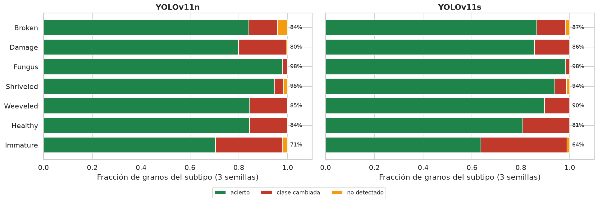
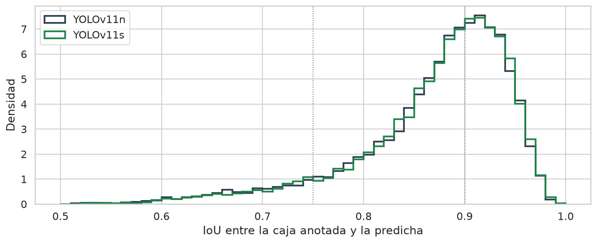
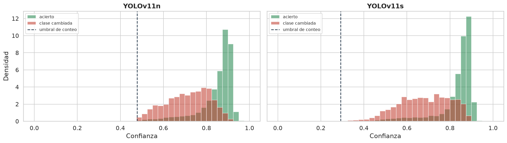
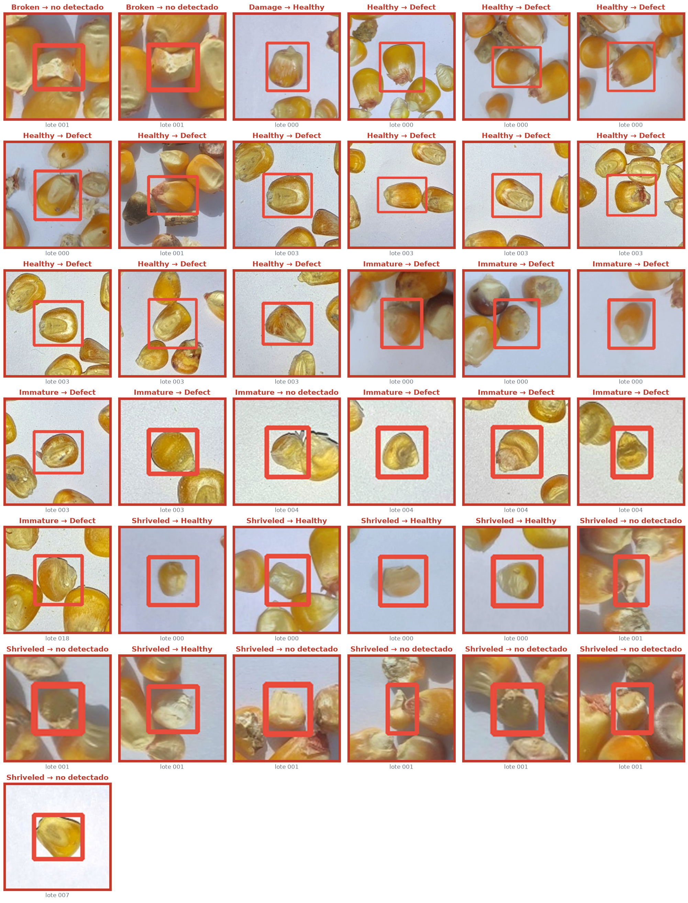
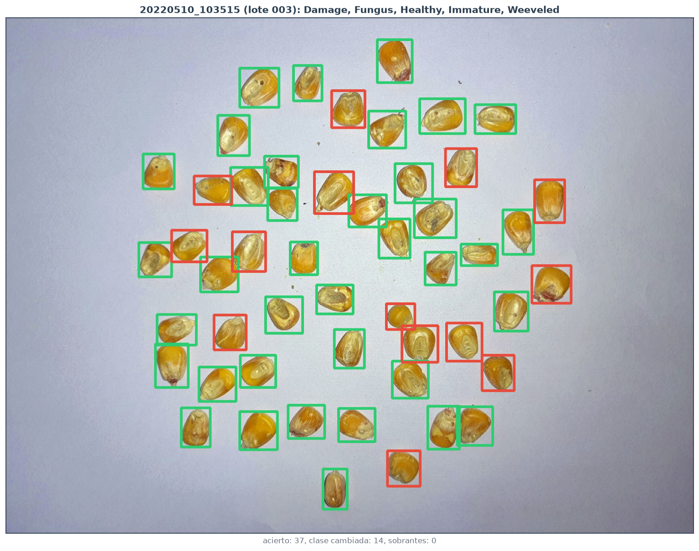
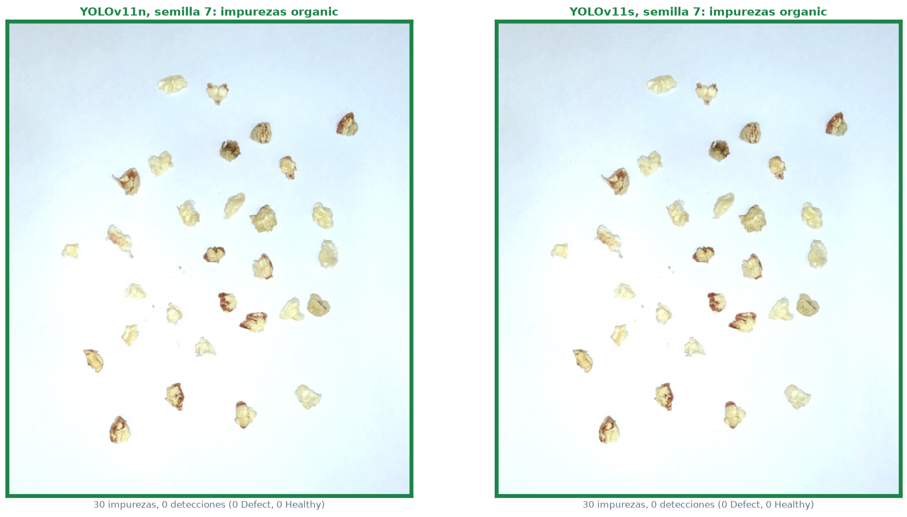

# Informe 2.2b: Diagnóstico de los Modelos Finales en `valid`

| | | | |
| :--- | :--- | :--- | :--- |
| **Proyecto:** | Detección de defectos en granos de maíz con YOLOv11 | **Fecha:** | 31 - 10 - 2026 |
| **Objetivo:** | Objetivo Específico 2, diagnóstico previo a la Actividad 2.3 | **Notebook:** | `2.2b_diagnostico_valid.ipynb` |
| **Modelos:** | `resultados/configuracion_final.json`: YOLOv11n y YOLOv11s, 3 semillas cada uno | **Figuras:** | `salida/2.2b_diagnostico_valid/` |
| **Datos:** | `valid` de `Data_final` (115 imágenes, 4 242 granos, 7 lotes); 18 impurezas y 3 hojas de medición de `valid` | | |

---

## 1. Planteamiento

Este diagnóstico identifica qué errores cometen los modelos finales de la 2.2. Se hace en `valid`; el test se reserva para la evaluación final (2.3).

**Preguntas:**
1. **Tipo de error:** ¿fallan al detectar, al contar, al clasificar o al ajustar la caja?
2. **Dónde fallan:** ¿qué subtipos, lotes y escenas concentran los errores, y son sistemáticos?
3. **Confianza:** ¿distingue la confianza los aciertos de los errores?
4. **Objetos que no son maíz:** ¿se detectan como grano las impurezas de los lotes de `valid`?

**Criterios:**
- Las métricas de aplicación usan la configuración final de cada modelo: su umbral de conteo (0.48 en YOLOv11n y 0.29 en YOLOv11s) y NMS agnóstico a la clase.
- Un grano está **detectado** si una predicción lo cubre con IoU ≥ 0.5, y **acertado** si además la clase binaria es la correcta. `Healthy` e `Immature` forman la clase `Healthy`; los demás subtipos, `Defect`.
- Una predicción **sobrante** no tiene grano emparejado. Es **de fondo** si su IoU con todo grano anotado es menor que 0.1.
- Un error es **sistemático** si lo cometen las 6 corridas (los dos modelos con sus 3 semillas).
- Las tablas usan las 3 semillas de cada modelo. Las figuras con predicciones muestran la corrida representativa de cada modelo, la de mAP50-95 mediano en `valid`: la semilla 7 en los dos.

`valid` se usó para elegir `best.pt` y el umbral de conteo, así que sus métricas son optimistas. El diagnóstico describe el tipo de error; no estima el rendimiento.

## 2. Composición de `valid`

| Conjunto | Imágenes | Lotes | Granos por imagen (mediana) | Imágenes con varios subtipos | Imágenes con las dos clases | Lado del grano (mediana) |
| :--- | :---: | :---: | :---: | :---: | :---: | :---: |
| `train` | 344 | 7 | 30 | 8 % | 8 % | 50 px |
| `valid` | 115 | 7 | 30 | 21 % | 21 % | 61 px |

| Lote de `valid` | Imágenes | Granos por imagen | Imágenes con las dos clases | Subtipos |
| :--- | :---: | :---: | :---: | :--- |
| `contador_DSC_000` | 10 | 31 | 0 % | `Fungus` |
| `tiempo_000` | 6 | 90 | 100 % | Los 7 |
| `tiempo_001` | 2 | 98 | 100 % | Los 7 |
| `tiempo_003` | 8 | 51 | 100 % | `Damage`, `Fungus`, `Healthy`, `Immature`, `Weeveled` |
| `tiempo_004` | 5 | 50 | 0 % | `Immature` |
| `tiempo_007` | 60 | 30 | 0 % | `Fungus`, `Healthy`, `Shriveled` (uno por imagen) |
| `tiempo_018` | 24 | 30 | 33 % | `Broken`, `Damage`, `Healthy`, `Immature`, `Shriveled`, `Weeveled` |

`valid` tiene más escenas mezcladas que `train`: el 21 % de sus imágenes contiene granos sanos y defectuosos, frente al 8 %. Esas escenas se concentran en 4 lotes.

## 3. Tipo de error

| | YOLOv11n | YOLOv11s |
| :--- | :---: | :---: |
| Granos acertados | 86.6 % | 85.2 % |
| Granos con la clase cambiada | 12.6 % | 14.4 % |
| Granos no detectados | 0.8 % | 0.4 % |
| Predicciones sobrantes por corrida: sobre un grano / de fondo | 35 / 37 | 41 / 44 |
| MAE de conteo (granos por imagen) | 0.46 | 0.70 |
| Error de conteo con signo | +0.31 | +0.59 |

*Media de las 3 semillas; 4 242 granos por corrida.*

- **Los modelos casi no pierden granos:** se detecta más del 99 % de los granos. **El error principal es de clase:** del 13 al 14 % de los granos se detecta con la clase binaria cambiada.
- **El conteo sobrestima ligeramente**, en +0.3 y +0.6 granos por imagen. Las predicciones sobrantes se reparten entre duplicados sobre un grano y detecciones de fondo. Se concentran en los dos lotes más densos (sección 4.1).

### 3.1. Clasificación por subtipo

| Subtipo (clase) | Granos | Acierto YOLOv11n | Acierto YOLOv11s | Clase cambiada YOLOv11n | Clase cambiada YOLOv11s |
| :--- | :---: | :---: | :---: | :---: | :---: |
| `Broken` (`Defect`) | 176 | 0.84 | 0.87 | 0.12 | 0.12 |
| `Damage` (`Defect`) | 214 | 0.80 | 0.86 | 0.20 | 0.14 |
| `Fungus` (`Defect`) | 837 | 0.98 | 0.98 | 0.02 | 0.02 |
| `Shriveled` (`Defect`) | 625 | 0.95 | 0.94 | 0.04 | 0.05 |
| `Weeveled` (`Defect`) | 358 | 0.85 | 0.90 | 0.15 | 0.10 |
| `Healthy` (`Healthy`) | 1 491 | 0.84 | 0.81 | 0.15 | 0.19 |
| `Immature` (`Healthy`) | 541 | **0.71** | **0.64** | 0.28 | 0.35 |

- **`Immature` es el subtipo más difícil:** entre el 28 y el 35 % se predice como `Defect`. Su acierto depende mucho de la semilla: de 0.43 a 0.87 en YOLOv11n y de 0.42 a 0.87 en YOLOv11s.
- **`Fungus` y `Shriveled` se reconocen bien** (94-98 %), y `Broken`, `Damage` y `Weeveled` se quedan entre 0.80 y 0.90.
- **El acierto por subtipo varía mucho entre semillas.** Por ejemplo, en YOLOv11n `Damage` va de 0.67 a 0.93 y `Weeveled`, de 0.75 a 0.96. Con 3 semillas, las diferencias de subtipo entre modelos no son concluyentes.

### 3.2. Ajuste de las cajas

| | YOLOv11n | YOLOv11s |
| :--- | :---: | :---: |
| IoU medio de los granos detectados | 0.87 | 0.87 |
| Granos con IoU ≥ 0.75 | 92 % | 92 % |
| Granos con IoU ≥ 0.90 | 42 % | 43 % |

- **El ajuste de la caja limita el mAP50-95.** Casi todos los granos se detectan con IoU ≥ 0.75, pero menos de la mitad supera 0.90; de ahí la distancia entre el mAP50 (0.95) y el mAP50-95 (0.71).
- **Los dos modelos ajustan igual.** Las cajas menos precisas son las de `Immature` (IoU medio de 0.83; solo el 20 % supera 0.90), `Shriveled` y `Weeveled` (0.85).

### 3.3. Confianza de aciertos y errores

| | YOLOv11n | YOLOv11s |
| :--- | :---: | :---: |
| Confianza mediana: aciertos | 0.88 | 0.86 |
| Confianza mediana: clase cambiada | 0.73 | 0.69 |
| Con confianza < 0.7: errores de clase señalados | 43 % | 53 % |
| Con confianza < 0.7: aciertos señalados | 8 % | 9 % |

**La confianza separa los errores solo en parte.** Un umbral de 0.7 permitiría señalar para revisión manual alrededor de la mitad de los errores de clase, a cambio de revisar el 8-9 % de los aciertos. La otra mitad de los errores se predice con confianza alta.

## 4. Dónde fallan

### 4.1. Lotes

| Lote | Escenas | Acierto YOLOv11n | Acierto YOLOv11s | MAE de conteo YOLOv11n | MAE de conteo YOLOv11s |
| :--- | :--- | :---: | :---: | :---: | :---: |
| `contador_DSC_000` | Una sola clase | 1.000 | 0.998 | 0.00 | 0.00 |
| `tiempo_007` | Una sola clase | 0.998 | 0.998 | 0.03 | 0.02 |
| `tiempo_018` | 33 % mezcladas | 0.945 | 0.946 | 0.22 | 0.24 |
| `tiempo_000` | Mezcladas, ~90 granos | 0.608 | 0.572 | 6.28 | 10.33 |
| `tiempo_001` | Mezcladas, ~98 granos | 0.624 | 0.496 | 2.83 | 5.67 |
| `tiempo_003` | Mezcladas | 0.646 | 0.681 | 0.04 | 0.00 |
| `tiempo_004` | Solo `Immature` | 0.625 | 0.523 | 0.33 | 0.07 |

- **Los errores se concentran en 4 de los 7 lotes:** los tres con escenas mezcladas y el de solo `Immature`. En los lotes con escenas de una sola clase, el acierto es prácticamente del 100 %.
- **El error de conteo se concentra en los dos lotes más densos** (`tiempo_000` y `tiempo_001`, con 90-98 granos por imagen). En ellos, los granos se tocan y aparecen predicciones duplicadas. En los demás lotes, el MAE no pasa de 0.33.

### 4.2. Escenas de una sola clase frente a escenas mezcladas

| Escena | Imágenes | Acierto `Healthy`: YOLOv11n / YOLOv11s | Acierto `Defect`: YOLOv11n / YOLOv11s |
| :--- | :---: | :---: | :---: |
| Una sola clase | 91 | 0.93 / 0.91 | 0.997 / 0.997 |
| Las dos clases | 24 | **0.54 / 0.44** | 0.77 / 0.82 |

- **En las escenas mezcladas, el acierto de los granos sanos cae a la mitad:** muchos se predicen como `Defect`. El acierto de los defectuosos también baja.
- **Esas escenas son escasas en el entrenamiento:** solo el 8 % de las imágenes de `train` contiene las dos clases (sección 2).
- **Interpretación:** es una asociación, no una causa demostrada. Las escenas mezcladas incluyen las imágenes más densas y reúnen los subtipos más difíciles.

### 4.3. Errores sistemáticos

De los 4 242 granos, 1 252 fallan en alguna corrida y **81 (1.9 %) fallan en las 6**:
- **65 son granos de la clase `Healthy` predichos como `Defect`:** 55 `Healthy` y 10 `Immature`. Solo el lote `tiempo_003`, de escenas mezcladas, reúne 40.
- **13 son `Shriveled`:** 7 predichos como `Healthy` y 6 sin detectar, sobre todo en los lotes densos.
- **3 son `Broken` y `Damage`.**

*Verde: acierto; rojo: clase cambiada.*

La imagen con más errores sistemáticos es una escena mezclada del lote `tiempo_003`. Los granos sanos predichos como `Defect`, en su mayoría, no muestran un defecto evidente a la vista, y comparten la escena con granos defectuosos.

## 5. Objetos que no son maíz

Las impurezas de medición de `valid` son de lotes que no se entrenaron, y las hojas no forman parte del entrenamiento.

| Fondo | Imágenes | Detecciones por imagen: YOLOv11n | Detecciones por imagen: YOLOv11s | Impurezas detectadas como grano: YOLOv11n | Impurezas detectadas como grano: YOLOv11s |
| :--- | :---: | :---: | :---: | :---: | :---: |
| Impurezas inorgánicas | 4 | 0 | 0 | 0 % | 0 % |
| Impurezas orgánicas | 14 | 0.24 | 1.86 | 0.8 % | 5.9 % |
| Hojas | 3 | 0 | 0 | — | — |

*Media de las 3 semillas, con el umbral de conteo de cada modelo.*

- **Ninguna impureza inorgánica ni ninguna hoja se detecta como grano.**
- **Las detecciones sobre impurezas orgánicas vienen casi todas de una corrida:** YOLOv11s con la semilla 42 suma 73 de las 78 detecciones de YOLOv11s; las otras dos semillas, 4 y 1. YOLOv11n suma 10 entre sus 3 semillas. La semilla 42 de YOLOv11s es la que la parada temprana detuvo en la época 103 (informe 2.2, sección 8.3).
- **Su confianza mediana (0.66) es menor que la de los granos (0.85-0.87), pero se solapa con ella:** el umbral de confianza no las elimina por completo.

## 6. Conclusiones

1. **La detección y el conteo funcionan:** se detecta más del 99 % de los granos. El error de conteo, de 0.46 a 0.70 granos por imagen, se concentra en las imágenes muy densas.
2. **El error principal es de clase,** del 13 al 14 % de los granos. Se concentra en las escenas con granos sanos y defectuosos mezclados y en `Immature`. En escenas de una sola clase, el acierto supera el 91 % en los sanos y el 99 % en los defectuosos.
3. **Los errores sistemáticos son sobre todo granos sanos predichos como `Defect` en escenas mezcladas,** en su mayoría sin un defecto evidente: el contexto de la escena se asocia con la clase predicha.
4. **El ajuste de las cajas limita el mAP50-95,** de forma similar en los dos modelos.
5. **La confianza señala alrededor de la mitad de los errores de clase:** sirve para revisar casos dudosos, no para descartar los errores.
6. **Los fondos negativos funcionan** en las impurezas de lotes no vistos, salvo en la corrida de YOLOv11s detenida antes de tiempo.
7. **Alcance:** `valid` tiene 24 imágenes con escenas mezcladas, de 4 lotes. La evaluación final (2.3) comprobará estos patrones en el test, con su propia composición.
