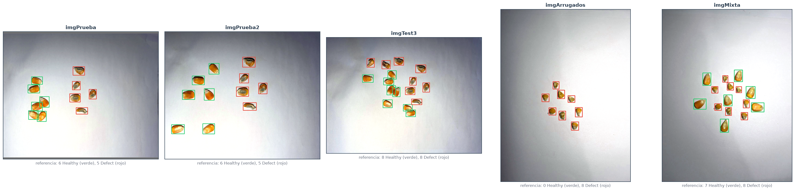
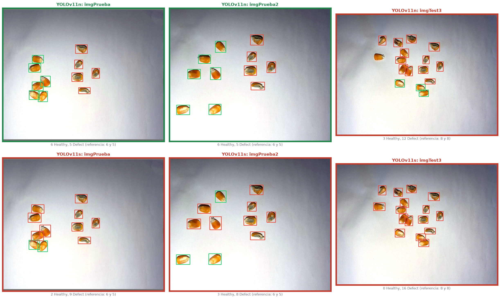
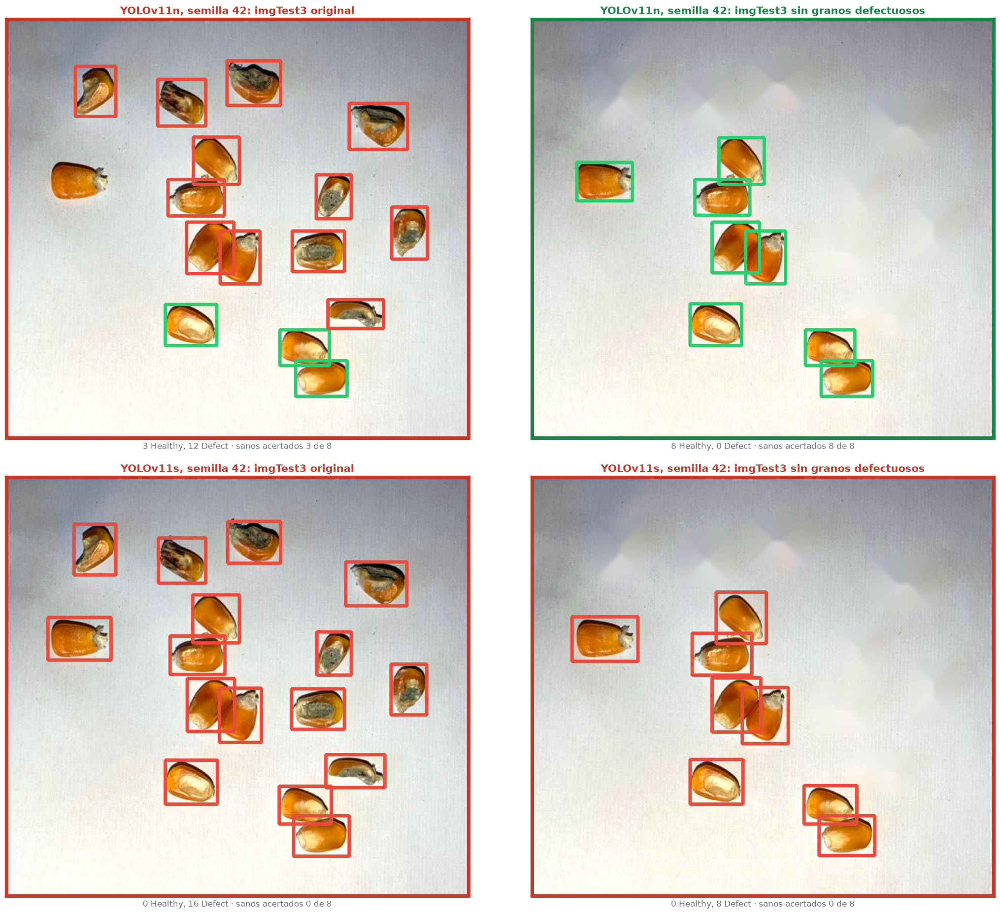
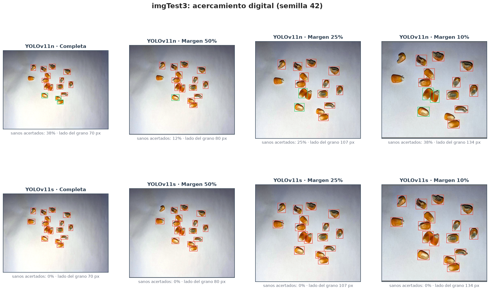
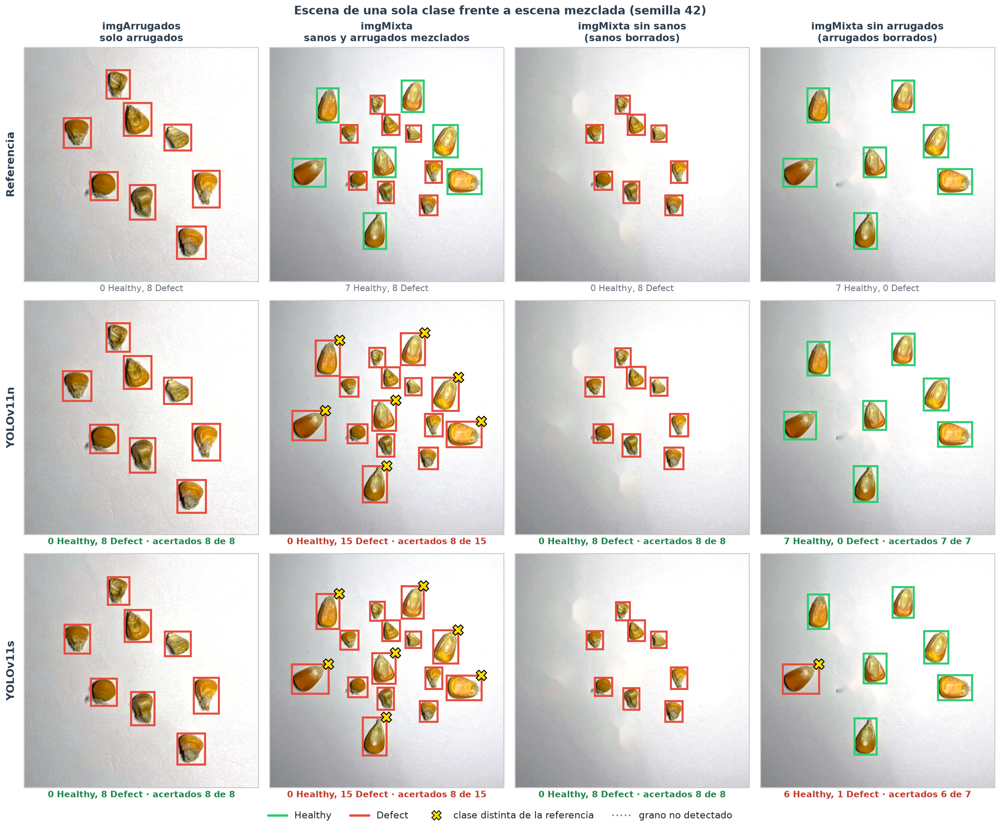

# Informe 2.2c: Comportamiento de los Modelos con Fotos Propias

| | | | |
| :--- | :--- | :--- | :--- |
| **Proyecto:** | Detección de defectos en granos de maíz con YOLOv11 | **Fecha:** | 31 - 10 - 2026 |
| **Objetivo:** | Objetivo Específico 2, comportamiento fuera del dataset | **Notebook:** | `2.2c_fotos_propias.ipynb` |
| **Modelos:** | `resultados/configuracion_final.json`: YOLOv11n y YOLOv11s, 3 semillas cada uno | **Figuras:** | `salida/2.2c_fotos_propias/` |
| **Datos:** | 5 fotos propias tomadas con smartphone (`fotos/propias/`, sin metadatos) y su referencia (`fotos/propias/referencia/`) | | |

---

## 1. Planteamiento

Los modelos finales se aplican a fotos tomadas con smartphone fuera del dataset: otra cámara, otra iluminación y otros granos. El objetivo es comprobar si el comportamiento observado en `valid` se mantiene en esas condiciones y, donde falle, explorar los factores asociados.

| Foto | Tamaño | Granos | Sanos | Defectuosos | Disposición |
| :--- | :---: | :---: | :---: | :---: | :--- |
| `imgPrueba` | 1496 × 1200 | 11 | 6 | 5 | Sanos a la izquierda, defectuosos a la derecha |
| `imgPrueba2` | 1463 × 1200 | 11 | 6 | 5 | Los mismos granos, en otra disposición separada |
| `imgTest3` | 1280 × 960 | 16 | 8 | 8 | Sanos y defectuosos mezclados |
| `imgArrugados` | 960 × 1280 | 8 | 0 | 8 | Solo granos arrugados (`Shriveled`) |
| `imgMixta` | 960 × 1280 | 15 | 7 | 8 | Sanos grandes y arrugados pequeños, mezclados |

- **Preprocesamiento:** cada foto pasa por `comun.preprocesar(img, 1280, 'norm')`, el mismo del dataset: lado mayor a 1280 px, normalización fotométrica y relleno hasta un múltiplo de 32.
- **Referencia, cajas:** consenso de las detecciones de las 6 corridas finales, es decir, la mediana de las cajas que coinciden (IoU ≥ 0.5) en al menos 4 corridas. En las 5 fotos, el consenso tiene exactamente un grano por cada grano de la foto.
- **Referencia, clase:** asignada por inspección visual. `Defect` si el grano tiene moho, está partido, arrugado o con manchas; `Healthy` en otro caso.
- **Criterios:** como en el diagnóstico (2.2b), con el umbral de conteo de cada modelo y NMS agnóstico a la clase. Un grano está acertado si una predicción lo cubre con IoU ≥ 0.5 y con la clase correcta.

## 2. Diferencias con `Data_final`

| | Lado del grano a 1280 px | Tono (H) del grano | Saturación (S) del grano | Brillo (V) del grano | Brillo del papel | Calidad JPEG |
| :--- | :---: | :---: | :---: | :---: | :---: | :--- |
| `Data_final` train (p5-p95) | 25-82 | 23-44 | 74-163 | 143-218 | 190-204 | 75, originales de 3000 a 4600 px |
| `imgPrueba` | 78 | 26 | 122 | 201 | 193 | 85, a 1496 × 1200 px |
| `imgPrueba2` | 89 | 29 | 119 | 190 | 195 | 85, a 1463 × 1200 px |
| `imgTest3` | 70 | 30 | 118 | 186 | 197 | 75, a 1280 × 960 px |
| `imgArrugados` | 56 | 24 | 106 | 185 | 196 | 75, a 960 × 1280 px |
| `imgMixta` | 52 | 23 | 114 | 197 | 196 | 75, a 960 × 1280 px |

*Medidas sobre las imágenes preprocesadas, normalizadas como el dataset.*

- **Color:** tras la normalización, el brillo del papel y del grano y la saturación de las fotos caen dentro del rango de entrenamiento. Los granos son algo más anaranjados (tono bajo) que la mayoría de los del dataset.
- **Tamaño del grano:** está dentro del rango, salvo `imgPrueba2`, un poco por encima.
- **Resolución:** las fotos tienen mucha menos resolución original que las del dataset.

Ninguna foto queda claramente fuera del rango de entrenamiento.

## 3. Conteo y clasificación

| Foto | Modelo | Detecciones, semillas 42 / 7 / 28 (referencia) | Sanos acertados | Defectuosos acertados |
| :--- | :--- | :---: | :---: | :---: |
| `imgPrueba` | YOLOv11n | 11 / 11 / 11 (11) | 100 % | 100 % |
| | YOLOv11s | 11 / 11 / 11 (11) | 78 % | 100 % |
| `imgPrueba2` | YOLOv11n | 11 / 11 / 11 (11) | 100 % | 100 % |
| | YOLOv11s | 11 / 11 / 11 (11) | 83 % | 100 % |
| `imgTest3` | YOLOv11n | 15 / 16 / 16 (16) | **21 %** | 100 % |
| | YOLOv11s | 16 / 16 / 16 (16) | **12 %** | 100 % |

*Aciertos: media de las 3 semillas.*

- **Conteo:** se mantiene fuera del dataset, con un error de un grano como máximo.
- **Defectos:** se reconocen todos, en las tres fotos y con los dos modelos.
- **Tomas con los grupos separados:**
  - YOLOv11n clasifica bien todos los granos con las 3 semillas;
  - YOLOv11s, con las semillas 7 y 28, también; con la semilla 42 marca como `Defect` 4 y 3 de los 6 sanos.
- **En `imgTest3`, con los granos mezclados, casi todos los sanos se predicen como `Defect`:**
  - YOLOv11n acierta 3, 1 y 1 de los 8 sanos con las semillas 42, 7 y 28;
  - YOLOv11s acierta 0, 3 y 0.

## 4. Exploración de factores

Se probaron, solo con inferencia, factores que pueden distinguir a `imgTest3` de las otras fotos.

**`imgTest3`** (media de las 3 semillas):

| Prueba | Sanos acertados: YOLOv11n | Sanos acertados: YOLOv11s | Defectuosos acertados: YOLOv11n | Defectuosos acertados: YOLOv11s |
| :--- | :---: | :---: | :---: | :---: |
| Original | 21 % | 12 % | 100 % | 100 % |
| Sin normalización fotométrica | 12 % | 4 % | 100 % | 96 % |
| Preprocesada a 960 / 1600 / 1920 px | 12 % / 50 % / 54 % | 38 % / 12 % / 33 % | 100 % / 92 % / 75 % | 100 % / 96 % / 92 % |
| **Granos defectuosos borrados de la foto** | **100 %** | **67 %** | — | — |
| Granos sanos borrados de la foto | — | — | 88 % | 79 % |

**`imgPrueba`:**

| Prueba | Sanos acertados: YOLOv11n | Sanos acertados: YOLOv11s | Defectuosos acertados: YOLOv11n | Defectuosos acertados: YOLOv11s |
| :--- | :---: | :---: | :---: | :---: |
| Original | 100 % | 78 % | 100 % | 100 % |
| Sin normalización fotométrica | 100 % | 78 % | 100 % | 100 % |
| JPEG calidad 50 / 30 | 100 % / 100 % | 67 % / 61 % | 100 % / 67 % | 100 % / 73 % |
| Desenfoque σ 1.5 / 2.5 | 100 % / 89 % | 72 % / 44 % | 100 % / 93 % | 100 % / 100 % |

- **Lo que más cambia las predicciones es el contexto.** Al borrar los granos defectuosos, YOLOv11n clasifica bien los 8 sanos con las 3 semillas, y YOLOv11s con las semillas 7 y 28. La semilla 42 de YOLOv11s, la que la parada temprana detuvo antes de tiempo, los sigue marcando como `Defect`. Al borrar los sanos, algunos defectuosos pasan a predecirse como `Healthy`: la clase depende de la composición de la escena.
- **La normalización fotométrica ayuda un poco:** sin ella, el acierto de los sanos de `imgTest3` baja. En `imgPrueba` no cambia nada.
- **La escala da mejoras parciales e irregulares.** A 1600-1920 px, YOLOv11n acierta la mitad de los sanos, pero pierde granos y defectos; YOLOv11s mejora a 960 px y no a 1600.
- **La compresión fuerte y el desenfoque afectan más a YOLOv11s** que a YOLOv11n, y solo en sus valores extremos.

**Escenas mezcladas en el entrenamiento:**

| | Granos sanos en escenas con las dos clases | Sanos a menos de 2 lados de grano de un defectuoso | Distancia mediana al defectuoso más cercano |
| :--- | :---: | :---: | :---: |
| `Data_final` train | 4 % de 5 733 | 100 % de 204 | 0.9 lados |
| `imgPrueba` | 6 de 6 | 0 % | 4.2 lados |
| `imgPrueba2` | 6 de 6 | 0 % | 4.3 lados |
| `imgTest3` | 8 de 8 | 62 % | 1.8 lados |
| `imgMixta` | 7 de 7 | 71 % | 1.9 lados |

- **En el entrenamiento, las escenas mezcladas son raras:** el 8 % de las imágenes de `train` tiene granos de las dos clases, y solo el 4 % de los granos sanos aparece en ellas.
- **En las fotos que fallan, los sanos están junto a los defectuosos;** en las que funcionan, separados.

Es una asociación coherente con el diagnóstico en `valid` (2.2b, sección 4.2), donde el acierto de los sanos cae a la mitad en las escenas mezcladas. No demuestra que sea la única causa.

## 5. Acercamiento del encuadre

Se comparó cada foto completa con recortes alrededor de los granos, con un margen del 50 %, 25 % y 10 %. Cada recorte pasa por el mismo preprocesamiento, así que los granos se ven más grandes a 1280 px. El acercamiento digital no añade detalle óptico, retira fondo y cambia las estadísticas de la normalización: sirve para explorar la sensibilidad a la escala y al encuadre, no para atribuir una causa.

| Encuadre de `imgTest3` | Lado mediano a 1280 px | Sanos acertados: YOLOv11n | Sanos acertados: YOLOv11s | Defectuosos acertados: YOLOv11n | Defectuosos acertados: YOLOv11s |
| :--- | :---: | :---: | :---: | :---: | :---: |
| Completa | 70 | 21 % | 12 % | 100 % | 100 % |
| Margen 50 % | 80 | 25 % | 8 % | 100 % | 96 % |
| Margen 25 % | 107 | 50 % | 21 % | 96 % | 100 % |
| Margen 10 % | 134 | **62 %** | 29 % | 96 % | 100 % |

- **YOLOv11n mejora al acercar el encuadre:** del 21 al 62 % de sanos acertados, aunque pierde un grano de media en los recortes más cercanos.
- **YOLOv11s apenas mejora**, del 12 al 29 %.
- **En `imgPrueba` e `imgPrueba2`,** YOLOv11n mantiene el 100 % en todos los recortes, y YOLOv11s varía entre el 72 y el 100 %.
- **El acercamiento no resuelve el fallo de la escena mezclada.**

## 6. Escena de una sola clase frente a escena mezclada

`imgArrugados` e `imgMixta` aíslan el efecto de mezclar clases, con granos distintos a los de las otras fotos. Sobre `imgMixta` se repitió la prueba de contexto: se borraron los sanos o los arrugados y se evaluaron los granos que quedan.

| Escena | YOLOv11n: semillas 42 / 7 / 28 | YOLOv11s: semillas 42 / 7 / 28 |
| :--- | :--- | :--- |
| `imgArrugados` (8 arrugados) | 8 / 8 / 8 acertados | 8 / 8 / 8 acertados |
| `imgMixta` (7 sanos y 8 arrugados) | todo `Defect` / 11 `Healthy` y 2 `Defect` / 10 `Healthy` y 2 `Defect` | todo `Defect` / todo `Defect` / todo `Healthy` |
| `imgMixta` sin sanos (8 arrugados) | 8 / 8 / 8 acertados | 8 / 8 / 8 acertados |
| `imgMixta` sin arrugados (7 sanos) | 7 / 7 / 7 acertados | 6 / 7 / 7 acertados |

- **Por separado, los dos grupos se clasifican bien en las 6 corridas** (salvo un sano con la semilla 42 de YOLOv11s).
- **Mezclados, cada corrida asigna casi la misma clase a toda la escena:** del 83 al 100 % de las predicciones son de una sola clase. Qué clase elige cambia de una corrida a otra.
- **YOLOv11n con las semillas 7 y 28 omite además 2 y 3 granos.**

## 7. Conclusiones

1. **El conteo se mantiene fuera del dataset:** un error de un grano como máximo en las fotos 1 a 3. En `imgMixta`, YOLOv11n omite de 2 a 3 granos con dos de sus semillas.
2. **Los defectos se reconocen bien** en las escenas sin mezcla y en `imgTest3`.
3. **Los granos sanos fallan en las escenas mezcladas.** En `imgTest3` se predicen como `Defect`, y en `imgMixta` cada corrida tiende a asignar una sola clase a toda la escena.
4. **Las intervenciones de contexto cambian las predicciones:** borrar un grupo de granos corrige la clasificación del otro. Es el mismo patrón del diagnóstico en `valid`, donde las escenas mezcladas concentran los errores.
5. **La normalización, la escala y el encuadre solo mejoran en parte,** y de forma distinta en cada modelo. Ninguno resuelve el fallo de las escenas mezcladas.
6. **YOLOv11s con la semilla 42 es la corrida menos robusta:** falla sanos incluso en las tomas separadas y tras borrar los defectuosos.
7. **Alcance exploratorio:** solo hay 5 fotos, dos de ellas con los mismos granos. Las clases se revisaron visualmente, y las cajas de referencia proceden del consenso de los modelos. Tres semillas no equivalen a nuevas escenas independientes.

## 8. Implicación: ampliación del dataset

Las intervenciones de inferencia no corrigen el fallo de forma uniforme. La limitación que señalan el diagnóstico y estas fotos es la escasez de escenas mezcladas en el dataset, y no se resuelve con hiperparámetros.

Por eso, el dataset se amplía con fotos propias tomadas con smartphone, con tres tipos de escena:
1. **Fotos de un solo subtipo,** de cada subtipo de maíz. Aportan la cámara y las condiciones de uso propias, con la misma estructura del dataset original.
2. **Más fotos de los subtipos minoritarios del dataset original,** como `Broken` y `Damage`, para reducir el desbalance de subtipos.
3. **Fotos multiclase,** con granos sanos y defectuosos mezclados en la misma escena y próximos entre sí. Cubren la situación que hoy falla y que el dataset original apenas contiene.

Los modelos finales de la 2.2 son el punto de partida: el entrenamiento continúa desde sus pesos (*fine-tuning*) con el dataset ampliado. El aumento C, que en la confirmación mejoró a YOLOv11s de media sin alcanzar la significación (informe 2.2, sección 6), queda como candidato para evaluarse con el dataset ampliado.
