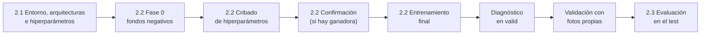

# Plan del OE2: Entrenamiento y Ajuste de los Modelos

| | |
| :--- | :--- |
| **Objetivo específico 2 (PIIC, no cambia)** | Entrenar los modelos YOLOv11n y YOLOv11s en un entorno controlado mediante transferencia de aprendizaje y el ajuste de hiperparámetros para la identificación, clasificación y conteo de granos de maíz sanos y con defectos superficiales, evaluando su desempeño mediante el registro de métricas de precisión, recall, mAP@0.5 y tiempo de inferencia. |
| **Punto de partida** | `datos/Data_final` (OE1): 1280 px, normalización fotométrica, sin balanceo; partición por lote (train 344 / valid 115 / test 54) |
| **Versión de referencia** | Ultralytics 8.4.174 y su documentación oficial |

---

## 1. Hoja de ruta

## 2. Principios

1. **El test solo se usa en la evaluación final (2.3).** Todas las decisiones y el diagnóstico de los modelos se hacen con validación.
2. **Primero los datos, después los hiperparámetros.** La fase 0 decide si el entrenamiento incluye fondos negativos; el ajuste de hiperparámetros se hace sobre el dataset elegido.
3. **Reglas fijadas antes de entrenar**, un factor por paso, en lugar de una búsqueda automática de hiperparámetros.
4. **Semillas:**
   - **13, 29 y 51** en toda la selección (fondos, cribado y confirmación): dentro de cada comparación, todas las alternativas usan las mismas semillas;
   - **42, 7 y 28** en los modelos finales, distintas de las de selección, para no evaluar con las mismas semillas con que se eligió la configuración.
5. **Misma GPU y mismo lote en todas las corridas:** NVIDIA A100 de Colab y lote 16.
6. **Resolución común de 1280 px** para los dos modelos. Se eligió con YOLOv11s en el OE1; que también sea adecuada para YOLOv11n se asume y se declara como limitación.
7. **Mismo preprocesamiento en toda inferencia:** las imágenes que no vienen de `Data_final` (fondos, fotos propias, aplicación) pasan por `comun.preprocesar` (letterbox a 1280 px y normalización fotométrica).

## 3. Actividad 2.1: entorno, arquitecturas e hiperparámetros

Sin entrenar. **Entregables:** el script de configuración del entorno y carga de las arquitecturas, el análisis de los hiperparámetros con evidencias y este diseño experimental.

1. **Entorno reproducible** (`2.1_entorno_arquitecturas.ipynb`): versiones de Python, PyTorch, CUDA, Ultralytics 8.4.174 y Albumentations 2.0.8, en local y en Colab; GPU y memoria.
2. **Arquitecturas y transferencia:** carga de `yolo11n.pt` y `yolo11s.pt` preentrenados en COCO; parámetros, capas y GFLOPs a 1280 px; qué se transfiere y qué se reinicia (la rama de clasificación pasa de 80 clases a 2).
3. **Perfil de memoria** con lotes reales de `Data_final` a 1280 px, para documentar qué cabe en cada GPU.
4. **Análisis de los hiperparámetros** (`2.1_hiperparametros.ipynb` y `2.1_aumento_datos.ipynb`): cada hiperparámetro de entrenamiento de Ultralytics se clasifica en *se ajusta*, *se desactiva*, *se mantiene por defecto* o *no aplica*, con justificación y, cuando corresponde, evidencia sobre imágenes de `Data_final`.

## 4. Actividad 2.2: entrenamiento y ajuste

### 4.1. Fase 0: fondos negativos

`Data_final` solo contiene granos. En una muestra real aparecen también impurezas y el papel de fondo. Los modelos del OE1, entrenados solo con granos, detectan como grano entre el 96 y el 99 % de las impurezas de sesiones que no vieron, casi siempre como `Defect`, y el umbral de confianza no las separa (informe 2.2, sección 2). Los fondos negativos (imágenes sin granos y con la etiqueta vacía) enseñan a la red qué no es un grano. El dataset de fondos se construye en `2.2a_fondos_dataset.ipynb` (informe 2.2, sección 3).

- **Comparación:** la configuración de referencia (sección 4.2) con y sin fondos, en `train` / `valid`, con los dos modelos y las 3 semillas de selección: 12 corridas.
- **Medidas:**
  - **falsos positivos** sobre las 18 impurezas de los lotes de `valid` (detecciones por imagen, con umbral 0.25 y NMS agnóstico);
  - **mAP50-95 en los granos de `valid`**: la validación usa siempre solo granos, para que sea comparable con y sin fondos.
- **Regla:** los fondos se adoptan si, **en los dos modelos**, los falsos positivos medios sobre las impurezas bajan **al menos un 90 %** y el mAP50-95 medio en los granos **no baja más de 0.005**.

Las corridas de la referencia con el dataset elegido sirven de referencia al cribado: no se repiten.

### 4.2. Factores del ajuste

| Factor | Valores | Notas |
| :--- | :--- | :--- |
| **Optimizador** | SGD (referencia), MuSGD, Adam, AdamW | Cada uno con su tasa estándar: 0.01 para SGD y MuSGD, 0.001 para Adam y AdamW. El modo `'auto'`, que con menos de 10 000 iteraciones elige AdamW, queda cubierto por AdamW. Adam y AdamW usan `warmup_bias_lr = 0`, como hace Ultralytics en su modo `'auto'`. |
| **Tasa de aprendizaje** | ×0.5 y ×2 de la tasa estándar del optimizador elegido | Por debajo y por encima del valor estándar. |
| **Aumento en línea** | A (referencia), B y C | A: el de Ultralytics por defecto. B: A más un conjunto propio de Albumentations. C: B más volteo vertical y giros de 90° (`2.1_aumento_datos.ipynb`). |

**Referencia:** los valores por defecto de Ultralytics (SGD, `lr0 = 0.01`, aumento A).

**Lote: no se ajusta.** Ultralytics acumula gradientes hasta un lote nominal de 64 (`nbs = 64`), así que el lote cambia sobre todo la velocidad, la memoria y las estadísticas de BatchNorm. Se usa el valor por defecto, **16**, en todas las fases.

**Épocas:** valores estándar, sin búsqueda:
- **100** (el valor por defecto) en el ajuste, para comparar configuraciones con el mismo presupuesto;
- **200 con `patience = 50`** en el entrenamiento final; las curvas documentan si convergen.

### 4.3. Cribado

En `train` / `valid`, por modelo. Los factores se prueban en orden (optimizador → tasa de aprendizaje → aumento), cada uno sobre la configuración elegida en el paso anterior. Cada configuración se entrena con las 3 semillas de selección y se compara por su mAP50-95 medio. Una alternativa pasa a ser la base si supera a la base vigente en **al menos +0.005** de mAP50-95 medio. El resultado es la ganadora del cribado.

### 4.4. Confirmación

Si la ganadora del cribado no es la referencia, se compara con ella en los **pliegues 0, 1 y 3 de la validación cruzada por lote del OE1 × 3 semillas** (9 comparaciones emparejadas por pliegue y semilla), con corridas propias y los fondos de cada pliegue si se adoptaron. Se adopta solo si mejora **al menos +0.005 de media y la mejora es significativa** (t pareada, p < 0.05); si no, se mantiene la referencia. Es la misma regla del OE1.

**El pliegue 2 se excluye:** su partición es idéntica a `train` / `valid` (mismas imágenes, mismos fondos y mismo orden). Con las mismas semillas, repetiría las corridas del cribado con las que se eligió la ganadora, y sus comparaciones favorecerían a la candidata. Este ajuste se fijó después del cribado y antes de entrenar la confirmación, al comprobar que ambas particiones coinciden; el plan inicial preveía los 4 pliegues.

### 4.5. Entrenamiento final

- Cada modelo con su configuración adoptada, 200 épocas con `patience = 50` y las semillas 42, 7 y 28, en `train` y con `valid` como seguimiento: 6 corridas.
- **Umbral de confianza para el conteo:** la mediana, entre semillas, del umbral que maximiza el F1 en `valid`, con NMS agnóstico a la clase (un grano, una caja). Queda fijado para todo lo que sigue.
- **Entregables:** los `best.pt`, los registros de configuración (`args.yaml`, el registro de corridas y las curvas) y las métricas en `valid` con media ± desviación entre semillas.

### 4.6. Métricas de cada corrida

- **Detección:** mAP50-95 (métrica de decisión), mAP50, mAP75, precisión, recall y AP por clase, en los granos de su validación.
- **Aplicación:** MAE de conteo y acierto por subtipo.
- **Fondos:** falsos positivos por imagen sobre las impurezas y las hojas de medición.
- **Costo:** épocas ejecutadas, mejor época, minutos, VRAM y GPU.

## 5. Después del entrenamiento

1. **Diagnóstico en `valid`** (`2.2b_diagnostico_valid.ipynb`): tipo de error (detección, clase, ajuste de cajas), subtipos, escenas y confianza de los errores. El test no se usa.
2. **Validación con fotos propias** (`2.2c_fotos_propias.ipynb`): fotos de smartphone fuera del dataset, preprocesadas con `comun.preprocesar`, para ver si el comportamiento se mantiene en condiciones distintas.
3. **Evaluación final (2.3):** una sola vez en el test, más las impurezas de los lotes del test y las fotos propias; métricas de detección, conteo y tiempo de inferencia; comparación de YOLOv11n y YOLOv11s entre semillas.

## 6. Número de corridas

| Fase | Corridas |
| :--- | :---: |
| Fondos: 2 modelos × 2 versiones × 3 semillas | 12 |
| Cribado: 7 alternativas por modelo × 3 semillas (la referencia viene de la fase 0) | 42 |
| Confirmación: 2 configuraciones × 3 pliegues × 3 semillas, por modelo que la necesite | 0 a 36 |
| Entrenamiento final: 2 modelos × 3 semillas | 6 |
| **Total** | **60 a 96** |

Todas en la misma GPU (A100 de Colab), con `nube/2.2_entrenamiento_colab.ipynb` y el paquete `nube/oe2_nube.zip`.
